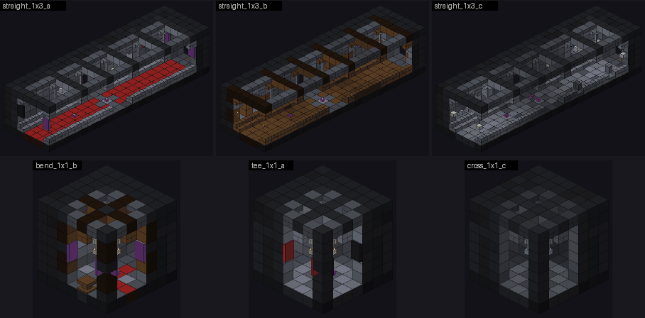
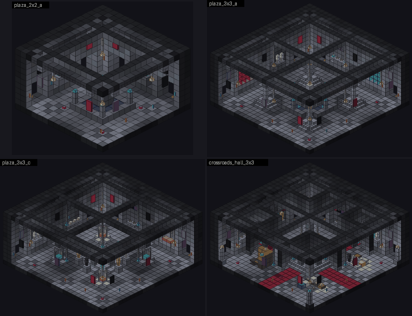
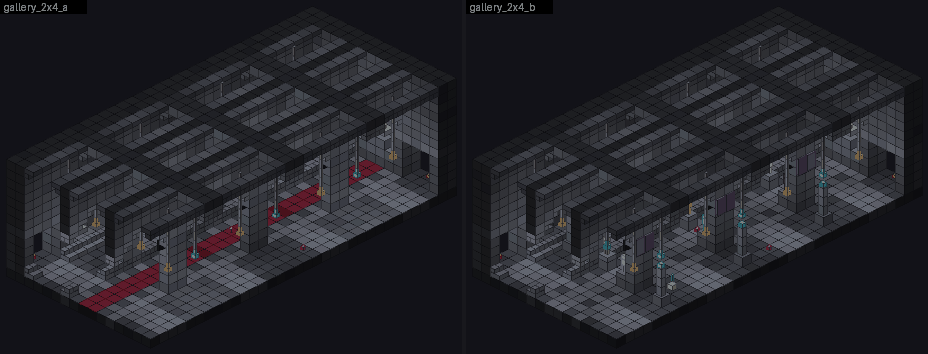
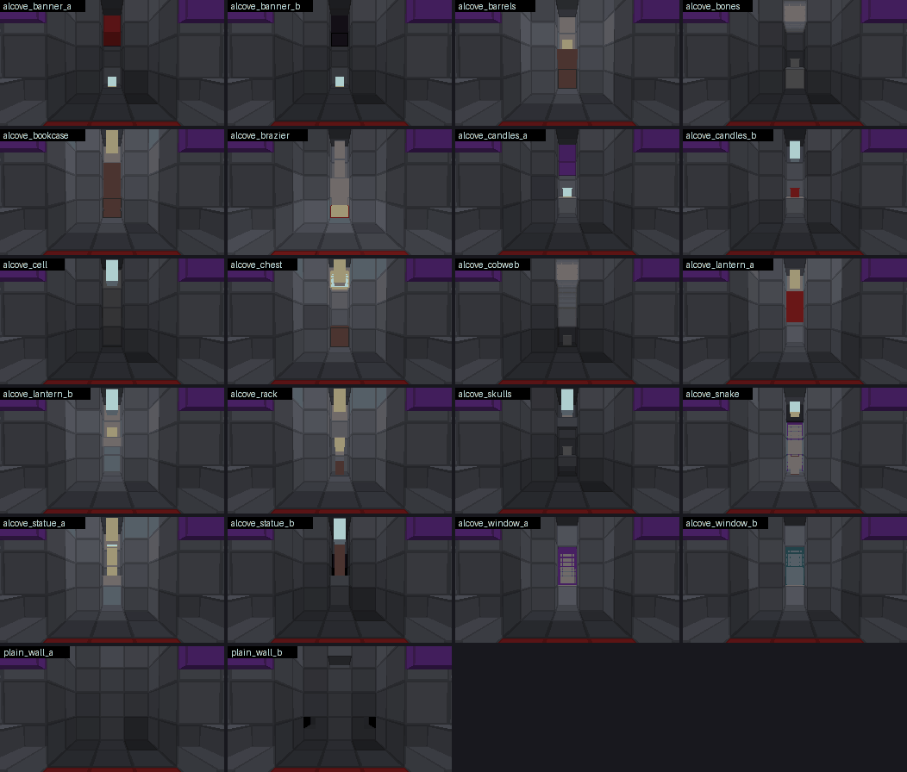
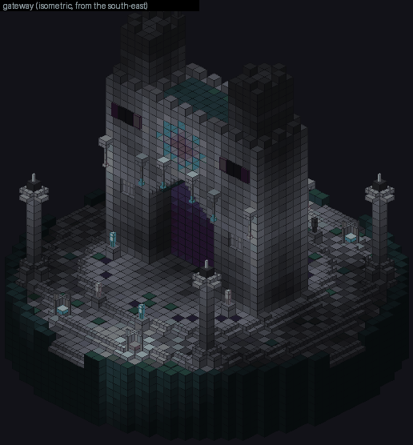
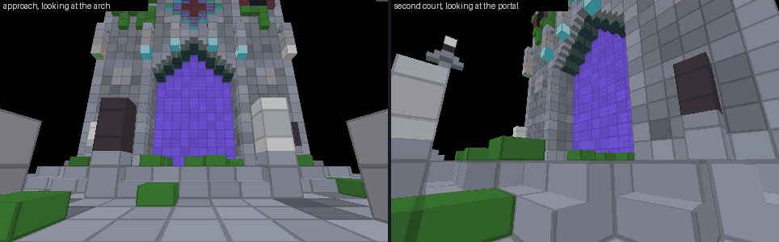

# The Mega-Dungeon, part ARCH: circulation, door caps, links, pools, processor list and the Overworld Gateway (1.54.0)

Builder key `mga`. Python and data only, no Java. Nothing here has been run in the game; what was checked offline, how, and what was NOT checked is
listed honestly in section 11. Master design: `docs/labyrinth/mega.md` (section 4 is the binding connector contract this part obeys).

---------------------------------------------------------------------------------------------------------------------------------------------

## 1. What this part is, and what is new, replacement, kept

The Mega-Dungeon is one expanding dungeon assembled from templates on a 9-block grid. The rooms of the other builders are the destinations; this part is
everything between them and around them:

| Piece | What it is | Where |
|---|---|---|
| Circulation set | straight corridors, bends, tees, crossroads, a colonnaded gallery, two plazas, a crossroads hall: what a player walks through | `structure/mega/corridor`, `structure/mega/junction` |
| Door caps | 22 small alcoves that end every doorway nothing was attached to | `structure/mega/cap` |
| Link pieces | the straight tunnel module and a waystation (CORE chains them between sectors) | `structure/mega/link` |
| Pools | all 15 template pools of the contract, filled from the folders | `worldgen/template_pool/mega/*.json` |
| Processor list | `nusmp:mega_interior` = region theme, then mod compat | `worldgen/processor_list/mega_interior.json` |
| The Gateway | the ONE entrance on the Overworld surface, placed once per world | `structure/mega_gateway`, `worldgen/structure*`, `worldgen/template_pool/mega_gateway`, tags |

* **NEW:** everything above. Nothing of it existed before, so by rule 5 there is no replacement.
* **REPLACEMENT:** none.
* **KEPT:** every old arch, gate, structure, tag and template. The only edit to an existing file is ONE appended value in
  `data/nusmp/tags/worldgen/structure/dungeon_gate.json` (`"nusmp:mega_gateway"`, so `/multiverse labyrinth locate` finds the new Gateway too).
  The old Root Gates and arches (`dungeon_gates` structure set) are not touched and still lead in.

Files (all generated, all deterministic: every random choice comes from a generator seeded with the template's own name, so the same script writes the same
bytes; `--check` of each generator proves it):

| Tool | Writes / does |
|---|---|
| `tools/labyrinth/gen_mega_arch.py` | corridors, chambers, gallery, links, and the command line (`--list`, `--check`, `--light`) |
| `tools/labyrinth/mega_arch_kit.py` | the shared motifs (pilaster, coved rib, niche, arch, chandelier, lamp post, statue ...) |
| `tools/labyrinth/mega_arch_rooms.py` | the plazas and the crossroads hall |
| `tools/labyrinth/mega_arch_caps.py` | the 22 door caps |
| `tools/labyrinth/mega_arch_check.py` | static "does it hold up in the game" checks, run on every piece before it is written (section 9) |
| `tools/labyrinth/gen_mega_pools.py`, `mega_pools.json` | the 15 pool files from the folders and the weights (section 6) |
| `tools/labyrinth/gen_mega_gateway.py` | the Gateway template and its data files (section 7) |
| `tools/labyrinth/mega_shape_preview.py`, `mega_walk_preview.py` | previews that show real block shapes, the block light and a first-person view (section 10) |

---------------------------------------------------------------------------------------------------------------------------------------------

## 2. The contract in the words this part needs

* **Module 9, centre cell 4.** Every piece is `9a x 48 x 9b`. A doorway is at a module centre (offsets 4, 13, 22, 31 ...) so that two touching pieces line
  up whatever their rotation.
* **Floor row 8 in every piece, height 48, walls 2 thick.** The interior is left unset (air). World floor is y = 64, the template origin y = 56.
* **A socket** = a 3 x 4 hole (rows 9..12) through both wall layers, a frame (polished columns, chiselled lintel), and a jigsaw block in the OUTER layer at row 9,
  `joint: aligned`, name = target = `nusmp:mega_door`, `final_state` air. `MT.socket()` of the lead's `mega_lib.py` writes all of it, so every piece obeys
  the contract by construction; `mega_check.py` agrees (section 11).
* **Palette.** Architecture uses only the palette constants of `mega_lib` (the deepslate family and the dark-oak family for timber), which the Region Theme
  processor swaps per sector. Everything else (lanterns, chains, candles, iron bars, banners, skulls, glass, wool, barrels, bookshelves ...) is left alone by
  the theme. The only custom block anywhere in this part is `nusmp:labyrinth_gate` (the portal, Gateway only).
* **Markers** are vanilla structure blocks in DATA mode (`nusmp:<kind>;k=v`). The game never places them, so a marker OCCUPIES its cell as far as the template
  is concerned: nothing else may share the cell. That is why the red runners of the corridors are WOOL BLOCKS in the floor row (a carpet in the standing
  cell would have a hole under every marker), and why `marker_standing()` raises when a cell is taken.
* **Rotation.** The assembler rotates pieces freely; every `facing`, `rotation` and `axis` in a template is rotated with the piece by the game.

---------------------------------------------------------------------------------------------------------------------------------------------

## 3. The circulation set





(Isometric sketches with the near walls cut away, from `mega_shape_preview.py`: flat colours, not game textures.)

### 3.1 Every template, with size and sockets

Sockets are listed as counts per side (N = north face ...); offsets are module centres along the face. "prio 1" = `selection_priority` 1 on the far-end
sockets, so the assembler draws the ends of a long piece first (a corridor goes somewhere before its side doors branch off, and a hall is a through-way).
Markers: P patrol, S spawn, F faction, C room_center.

| Template | Size (x y z) | Sockets | Markers | Dressing |
|---|---|---|---|---|
| `corridor/straight_1x2_a` | 9 x 48 x 18 | N, S | P S | stone, lanterns, red runner, banners at the ends |
| `corridor/straight_1x2_b` | 9 x 48 x 18 | N, S | P S | dark-oak ribs, checker floor, brown runner, shelves and candles |
| `corridor/straight_1x2_c` | 9 x 48 x 18 | N, S | P S F(undead) | ruin: soul light, broken ribs, rubble, cobwebs, bones |
| `corridor/straight_1x3_a/b/c` | 9 x 48 x 27 | N, S (prio 1), E, W at 13 | P S (F in c) | as above |
| `corridor/straight_1x4_a/b/c` | 9 x 48 x 36 | N, S (prio 1), E, W at 13 and 22 | P, 2 S (F in c) | as above |
| `corridor/bend_1x1_a/b/c` | 9 x 48 x 9 | N, E | P S (F in c) | 5x5 chamber, corner piers, chandelier, a tall niche on each blank wall |
| `corridor/tee_1x1_a/b/c` | 9 x 48 x 9 | N, E, W | P S (F in c) | the same, one blank wall |
| `corridor/cross_1x1_a/b/c` | 9 x 48 x 9 | N, E, S, W | P S (F in c) | the same, no blank wall |
| `corridor/gallery_2x4_a` | 18 x 48 x 36 | 12: E 4, W 4 (at 4, 13, 22, 31), N 2, S 2 (at 4, 13; prio 1) | P, 2 S | processional: red runner, banners, lanterns |
| `corridor/gallery_2x4_b` | 18 x 48 x 36 | 12 (as above) | P, 2 S, F(construct) | hall of statues: six armour stands, lamp posts, cobwebs |
| `junction/plaza_2x2_a/b/c` | 18 x 48 x 18 | 8: 2 per side | 2 P, 2 S, C (F in c) | fountain / fire pit / statue ring |
| `junction/plaza_3x3_a/b/c` | 27 x 48 x 27 | 12: 3 per side | 2 P, 2 S, C (F in c) | round fountain / well with canopy / ring of eight statues |
| `junction/crossroads_hall_3x3` | 27 x 48 x 27 | 12: 3 per side (the middle ones prio 1) | 2 P, 2 S, F(cultist) | cross of arcades, dais, four chapels |
| `link/straight_a`, `straight_b` | 9 x 48 x 9 | N, S (pool `nusmp:mega/link`) | P | plain module: stone / timber |
| `link/waystation` | 9 x 48 x 9 | N, S (pool `nusmp:mega/link`) | P | bench, fire basket in a niche, lanterns |
| `cap/*` (22) | 3 x 6 x 2..5 | 1 (the jigsaw at (1,1,0) `north_up`, pool `minecraft:empty`) | none | section 4 |

Interior heights: corridors 6 rows, junction chambers 7, 2x2 plazas 10, 3x3 plazas 12, hall 12, gallery 12 (rows 9 and up; the floor is row 8).
All 52 pieces are checked by `mega_check.py`; the Gateway template is 39 x 46 x 39 and is not a sector piece.

### 3.2 The language of the pieces (why they look like one family)

The owner wants every room to read as hand-crafted. Hand-crafted means a small number of good details used with rhythm and variety, not forty one-off
pieces of code, so every piece is written from the same kit (`mega_arch_kit.py`) in a different dressing (`Style`):

* **Flush pilasters.** A pier in the INNER wall layer (polished stone, a stripped dark-oak log in a timber corridor) with a chiselled plinth and band. Flush, so
  the corridor stays five wide everywhere (a free walking width), but it reads as a column because its material differs from the bricks around it. Pilasters
  stand at both ends of a corridor and flank every side door (door centre +- 2, so a pilaster continues each door frame); the stretches between are split
  so that no bay is wider than four cells (`bay_layout`).
* **Coved ribs and a cove.** A band one block under the ceiling across the corridor at every pilaster, with upside-down stairs flaring into the walls (a
  corbel), and a cove of upside-down stairs along both walls between the ribs: the ceiling meets the wall in a curve instead of a corner. In the `c`
  variants some ribs have fallen (only the corbels remain), the way a ruin loses them.
* **Skirting, string course, medallions.** A one-step plinth of stairs along the walls (walkable: a stair is a half block); a course of chiselled and
  polished blocks at the springing row that matches the door lintels; an inlay in the floor where lanes cross.
* **Niches.** In every bay between two pilasters the inner wall layer is carved three rows tall with a stair arch on top, so the OUTER layer is the back of
  the recess and nothing ever opens to the void. Contents: a standing lantern, a banner, a skull and candles on a TOP slab (a bottom slab would leave a
  half-block gap under the item), a bookshelf, a barred slit with a warm backlight, a sconce (a skull with a torch above it). Never the same feature twice in
  a row on one side.
* **Light.** Hanging lanterns on chains down the middle (soul lanterns in the ruins, mixed in the timber ones), a chandelier where the ribs cross in the 1x1
  chambers and the hall, wall torches on door columns in the plazas, lamp posts, candles. The gloom clock counts block light <= 4, so every piece must stay
  above it (section 8).
* **Clutter** against the wall foot: barrels, a pile of bones with a skull, a heap of fallen masonry (cobbled slab, stairs and a wall post), cobwebs in the
  upper corners (high, never in the walking line).
* **Variants.** `a` is the maintained stone version with a red runner, `b` the timber version (dark-oak ribs and skirting, a checker floor, shelves), `c` the
  ruin (soul light, cobwebs, rubble, bones, broken ribs). The same plan, three places.

### 3.3 The 1x1 chambers (bend, tee, cross)

A 9 x 9 module has a 5 x 5 interior, and its doorways are 3 wide in a 5-wide wall, so the plan is already a plus. The chamber fills the four corners with
piers (the way a vault's groin ribs would) that carry banners and the cross of ribs, with a boss at the centre and a chandelier of five lanterns hanging from
it. The blank walls of a bend (two) and of a tee (one) hold a tall niche with a feature: statue, brazier, shrine, library with a lectern, a glowing stained-glass
window, a ruin of fallen masonry, a shelf of skulls with a soul torch.

### 3.4 The gallery

18 x 36 with a 4-wide nave between two 4-wide aisles, divided by arcades of 7- and 6-wide pointed arches on pier pairs (the arch is built by `pointed_arch`:
upside-down stairs rise one cell per side per row and close in a keystone, wall above). Ribs run across the whole width over the piers, chandelier-like
pairs of lanterns hang in the nave, a lantern hangs under the keystone of every arch (it lights nave and both aisles at once), a lantern hangs in every aisle
bay, and at each end of the nave a tall apse niche holds a stained-glass window glowing over an altar of candles. Twelve doors: all four module centres of both
long sides, both of each end.

### 3.5 The plazas and the hall

A plaza has a door at every module centre of every side, so wherever the assembler attaches something a 3-wide lane of polished stone should lead from
it across the room. Every plaza is therefore drawn as a grid of lanes (`plaza_floor`), a rib over every lane line (`plaza_ceiling`), frame columns running up the
walls from every door, a banner over each door, a torch on one column of each door (warm and soul flames alternate), and a tall niche in each four-cell bay
between two doors (`plaza_walls`). Only the feature in the middle and the dressing differ:

| Template | Middle | Bays |
|---|---|---|
| `plaza_2x2_a` | square fountain: polished rim, a ring of still water, a 2x2 plinth with a golden armour-stand statue exactly on the centre line, lamp posts on the rim corners | statue |
| `plaza_2x2_b` | fire pit on a one-step dais: four campfires (two soul) behind an iron-bar fence, corner posts with soul lanterns | banners, brazier |
| `plaza_2x2_c` | statue ring: a 6x6 dais, a plinth with two soul-lit posts, a statue of a different kit on every corner (faction construct) | window, shrine |
| `plaza_3x3_a` | two-tier round fountain with lamp plinths in the quarters | shrine, window, statue, window |
| `plaza_3x3_b` | a well under a timber canopy with benches, four planters | casks, library, casks, banners |
| `plaza_3x3_c` | eight statues round a round dais with a fire basket, a small brazier in each quarter (faction construct) | banners, brazier, skulls, statue |

Why the middle of a 2x2 plaza is a statue and not a pillar: the room is 18 blocks wide, so its centre is the line between two cells. A block cannot stand on
that line, an armour stand (an entity) can. The `room_center` marker therefore sits on a lane cell (the feature occupies the true middle).

**Water.** Every water cell is a source block with full blocks on its four sides and below. A source next to air starts to flow when the game ticks it, which
would flood a plaza; `mega_arch_check.py` fails the build if a water cell is open to the side or below.

**The crossroads hall** (27 x 27): a cross of two 7-wide arms between four 7x7 chapels, each opening to the arms through a pointed arch, a dais with a fire
basket and four lamp posts where the arms meet, and a chandelier above it. Why chapels: the corners of a cross would be dead masonry; as chapels they give the hub
four small rooms (a shrine with a golden statue, an armoury with armour stands, an anvil, a grindstone, a smithing table, a blast furnace and a lava cauldron, a
library with a lectern holding a real book, an alchemist's bench with brewing stands and cauldrons) and an extra door each from outside.

### 3.6 Markers and the faction hint

* `patrol` in the middle of every circulation piece and `spawn` (1-2 per piece, fewer in corridors) as the brief asks. The Javadoc of `RoomKind.isCirculation()`
  says circulation rooms have "no spawn, no patrol node of their own"; that sentence contradicts the brief and the encounter director reads the sector's
  markers regardless of the room kind, so the markers stay (see section 12).
* `faction` hints (undead in the ruin corridors and chambers, construct in the statue rooms, cultist in the hall) are written where they make sense. The ECO brief
  gives no native faction to circulation rooms, so as things are they are inert data; they cost nothing and are there the day circulation gets a faction.
* No `as=` compat hints: the circulation set has no furniture that a compat mod should replace.

---------------------------------------------------------------------------------------------------------------------------------------------

## 4. Door caps (`structure/mega/cap/*`)



(First-person views from the far end of a corridor straight at the doorway, each cap attached to a `straight_1x2_a`.)

A room has a doorway at every module centre of every side. The assembler attaches what it can; the rest would be holes into the void. A cap is a small plug that
continues the doorway outward and closes it: a bricked-up arch, a lantern niche, a statue, a cell. From inside the room a player sees "a door to a closet"
where there is no room behind the wall, and the tight dungeon never shows its emptiness.

**Geometry** (cap-local cells; x across 0..2, y 0..5, z 0..depth-1): y = 0 is the floor row (it lines up with room row 8), y = 1..4 the four open rows (rooms'
rows 9..12), y = 5 the roof row. z = 0 is the layer that touches the room's outer wall layer. The jigsaw is at (1,1,0), `north_up`, name = target =
`nusmp:mega_door`, pool `minecraft:empty`, `joint: aligned`. Its `final_state` is air for an open alcove or a plain full block for a bricked-up one. The state is NOT
rotated with the piece (the game's jigsaw replacement does not rotate it), so it is never a block with a facing.

**Why every cap is a one-block-wide slot between two walls.** The brief (and the contract wording "same 3x4 as the hole") would leave the cap's cavity 3 wide, but
the cap IS only 3 wide (the checker enforces 3 x 6 x 1..8) and the world around it is void. A three-wide cavity in a three-wide box has no flank walls: both
sides would be open to the void. The only way to leave no side open is to wall both flanks inside those three cells, which leaves the middle column free. From the
room it reads as a deep recess behind a framed doorway; props stand in the slot. Every cap has a floor, a roof, two side walls of palette bricks and a back
wall, so no void is ever visible.

| Cap | Depth | What is in it | Pool weight |
|---|---|---|---|
| `plain_wall_a` / `_b` | 2 | the doorway bricked up: clean masonry / a hasty infill of rubble | 6 / 4 |
| `alcove_lantern_a` / `_b` | 3 | a hanging lantern and a red banner / a standing lantern on a shelf and a soul lantern above | 4 / 3 |
| `alcove_candles_a` / `_b` | 3 | a top slab carrying four lit candles (plain / red), a purple banner / a hanging soul lantern | 3 / 2 |
| `alcove_banner_a` / `_b` | 3 | a hanging banner (red / black) and a candle | 3 / 3 |
| `alcove_statue_a` / `_b` | 3 / 4 | an armour-stand statue on a plinth (iron under a lantern / golden before a black banner) | 2 / 1 |
| `alcove_bookcase` | 3 | a lectern with a real book in front of a wall of bookshelves | 2 |
| `alcove_skulls` | 3 | two shelves of skulls and a soul lantern | 2 |
| `alcove_brazier` | 3 | a campfire under an iron-bar lid on a polished foot, chained to the roof | 2 |
| `alcove_window_a` / `_b` | 4 | a stained-glass pane (purple / cyan) in front of a `light` block and a froglight: a window that glows | 2 / 2 |
| `alcove_snake` | 4 | a miniature snake portal: waxed oxidised copper frame, purple glass in front of a froglight, a blackstone head with an end-rod tongue | 1 |
| `alcove_cell` | 5 | a grille of iron bars one block in, behind it a skull on a bone block and a chain from the roof | 1 |
| `alcove_chest` | 3 | a loot chest (`nusmp:chests/labyrinth_trial`) under a lantern, a cobweb in the corner | 1 |
| `alcove_barrels` | 3 | two stacked barrels with a lantern on top | 2 |
| `alcove_bones` | 3 | a heap of bones with a skull and cobwebs | 2 |
| `alcove_cobweb` | 3 | choked with cobwebs round a lone skull | 2 |
| `alcove_rack` | 3 | an armour stand in a helmet and chain mail holding an axe, a lantern over its head | 2 |

Notes: the lead's `mega_lib.cage` (3x3x4) and `mega_lib.snake_portal` (7 wide) do not fit a one-block slot, so the cell and the snake are written for it. The `light` block
in the window caps is invisible in survival and counts as real light for the gloom clock. The loot table `nusmp:chests/labyrinth_trial` exists in the repo (iron, gold, arrows,
bread, golden apple, experience bottles, magic stones).

---------------------------------------------------------------------------------------------------------------------------------------------

## 5. Link pieces (`structure/mega/link/*`)

`straight_a` (stone) and `straight_b` (timber) are plain five-wide corridor modules with a coved rib, two lanterns, a lit niche in each side wall and sockets N
and S with pool `nusmp:mega/link`. `waystation` is the same module with a bench of stairs along the west wall, a fire basket in a tall niche in the east wall and
mixed lanterns. Why a module of their own: when the next sector's region would collide with an old one, CORE chains these between the two (a waystation every eighth),
so a tunnel of any length is built from pieces that line up on the grid and cost no new rules.

---------------------------------------------------------------------------------------------------------------------------------------------

## 6. The pools and the processor list

`tools/labyrinth/gen_mega_pools.py` scans `structure/mega/<folder>/*.nbt` and writes every pool of the contract table; `tools/labyrinth/mega_pools.json` holds the numbers.
Run it again whenever another builder adds templates (dropping a template into the right folder registers it). `--check` reports stale files without writing.

**How a weight is computed.** For a pool with `folders` (folder -> share), the weight of a template is `share * scale * relative / sum(relative of that folder's templates)`,
rounded, at least 1, with `scale` 20. The SHARE of a folder in the pool therefore stays what `mega_pools.json` says, however many templates the folder holds: a builder who adds
ten halls does not drown the corridors. `relative` gives templates of one folder different weights (longest id prefix wins, default 1). A pool with `absolute: true` uses
`relative` as plain weights. `filter` keeps only files whose name starts with it (`one_`, `straight_` ...). Vanilla limits a weight to 1..150. `empty` adds an empty pool element.
The output is sorted and idempotent.

| Pool | Elements today | Total weight | Fallback | Notes |
|---|---|---|---|---|
| `side` | 27 templates + 1 empty | 160 | `nusmp:mega/cap` | folder shares: corridor 5, junction 3, hall 3, trap 1, puzzle 1, trial 1, treasure 1, cavern 1, set 1, safe 1; inside `corridor`: straight_1x2 3, 1x3 3, 1x4 2, bend 2, tee 2, cross 1, gallery 1; inside `junction`: plaza_2x2 3, plaza_3x3 2, crossroads_hall 2; one empty element of weight 2 |
| `cap` | 22 | 52 | `minecraft:empty` | absolute weights (table in section 4) |
| `link` | 3 | 9 | `nusmp:mega/cap` | `straight_a` 4, `straight_b` 4, `waystation` 1 |
| `landing`, `safe`, `arena`, `antechamber`, `vault`, `vault_1`, `vault_2`, `vault_3`, `onward`, `onward_straight`, `onward_left`, `onward_right` | 0 | 0 | `nusmp:mega/cap` | EMPTY today: their folders belong to other builders; the files are written with no elements and `mega_check.py` reports the 12 "no elements" errors until they arrive |

Today only the corridor and junction folders exist, so the 160 of `side` is what those two shares scale to (corridor 5 x 20 = 100 and junction 3 x 20 = 60, which rounding turns into 97 and 61)
plus 2 for the empty element. When the other folders fill, `side` grows to 18 shares x 20 = 360 and the corridors fall from about 61% to about 28% of it, as designed.

**The empty element.** A jigsaw that draws `minecraft:empty_pool_element` does NOT leave a doorway open: the assembler then draws the fallback pool (a door cap). So the empty
element only thins out connectivity; weight 2 of 160 keeps the dungeon tight.

**Why the `cap` pool has fallback `minecraft:empty`:** the cap's own jigsaw has pool `minecraft:empty`, and a cap that cannot be placed leaves the niche backed by the wall.

**Processor list `nusmp:mega_interior`** = `[nusmp:region_theme, nusmp:mod_compat]`, in that order (the theme swaps the wood and stone families first; the compat swap then replaces
furniture). Both processor types are registered by other builders (`mega_check.py` knows them as contract types). Every pool element points at it, with `projection: rigid`
(a template has a fixed floor row, so nothing needs terrain matching).

---------------------------------------------------------------------------------------------------------------------------------------------

## 7. The Overworld Gateway (the ONE entrance)




### 7.1 What it is

`structure/mega_gateway/gateway.nbt`, 39 x 46 x 39, 14458 blocks, 8 armour stands, 106 portal blocks. A ruined citadel gate on the surface:

* a 39-wide round platform of three terraces (each one step up) on a foundation that runs from the bottom of the box up to the paving (buried on flat ground, a retaining skirt
  on a slope), a curb ring of reinforced deepslate round it with four gaps for approach steps;
* in the middle two stout pylons (6 wide, 7 deep) with setback towers and a crenellated top, joined by a bridge over a NINE-wide pointed arch;
* the arch opening is a single plane of `nusmp:labyrinth_gate` blocks (9 wide at the base, the pointed top above it, rows 10..23) in the middle layer of the tunnel;
* rose windows (stained glass in front of froglights) and banners on both faces of the bridge, arrow slits, brackets with hanging lanterns beside the opening, soul lanterns hanging in front of the crown;
* four 14-tall obelisks (crying obsidian tip with an end rod) and four fire baskets on the outer court, eight armoured statues on plinths (four at the feet of the pylons on the third court,
  four guarding the processional path on the second), glyph studs on the jambs, a ring of chiselled blocks and crying obsidian on the dais round the gate;
* weathering: moss carpet, rubble at the pylon feet, vines on the north faces, bites out of the crenellation, cracked bricks.

Vanilla blocks only; the portal block is the one custom block. The placement uses the existing processor list `nusmp:gate_weathering` (moss and cracks on stone and deepslate families).

### 7.2 Why three kinds of hard block, and what "unbreakable" honestly means

The Overworld is not held by the Dungeon Guard (the Mega-Dungeon's dimension is), so only the blocks themselves protect the Gateway.

1. **The portal blocks** (`nusmp:labyrinth_gate`) are indestructible by their own properties (`labyrinth/gate/GateBlock`: destroy time -1, explosion resistance 3,600,000, documented in `c_gate.md`).
2. **The cores of the pylons and towers**, hidden behind a brick shell (976 blocks), are `minecraft:bedrock`. Nobody mines bedrock in survival and no explosion breaks it, so a griefer who digs into a
   pylon reaches a wall he cannot pass. The cores are never visible: the cells behind the arrow slits are brick and the tower roof is polished stone (checked: no bedrock cell has an exposed face).
3. **Everything visible that touches the portal plane** (tunnel faces, arch, bridge) **and the curb ring** (1451 blocks) are `minecraft:reinforced_deepslate`. It is not obtainable in survival (no drops).
   As far as I remember the block (NOT verified offline; the API dump has no hardness values) its blast resistance is 1200, like obsidian, so no creeper, TNT, wither or crystal chain breaks it,
   but its hardness is 55 with no tool requirement, which makes it mineable in survival by hand in roughly a minute and a half per block. So the visible frame survives every explosion and stops casual
   damage, but it is NOT "unbreakable in survival play" as the brief put it: a patient survivor can chew a hole in it. What he can never remove is the gate and the cores.

What is NOT protected on purpose: the terraces, steps, statues, banners and braziers (a ruined citadel may lose them). Creative players, commands and mods that ignore hardness can remove anything.
The brief asked for reinforced deepslate for the arch frame and the platform ring; the bedrock cores are an addition so that "hard to destroy" is also true for a survival player with a shovel.
If the owner wants the visible frame to be survival-proof too, change `REINFORCED` in `gen_mega_gateway.py` to `minecraft:bedrock` (one word; it will look like bedrock).

### 7.3 Why a concentric-rings structure set of its own

`worldgen/structure_set/mega_gateway.json` places the structure with `minecraft:concentric_rings`, `distance` 5, `spread` 1, `count` 1, `salt` 1540154 and `preferred_biomes`
`#nusmp:has_structure/mega_gateway_preferred`:

* **Concentric rings is the vanilla way to say "exactly this many per world"** (strongholds use it with count 128). With count 1 the world gets one Gateway. The first ring lies at about
  4 x `distance` chunks from the world origin, +- 1.25 x `distance` chunks, so with distance 5 the one Gateway is 14 to 26 chunks (about 220 to 420 blocks) from the origin.
* **A fresh structure set** (not an edit of `dungeon_gates`) keeps the old arches untouched (rule 2); they still lead into the Mega-Dungeon (config `mega.legacyGates`).
* **`preferred_biomes`** nudges the ring position to the nearest preferred biome within 112 blocks, so the Gateway is not drawn on the sea floor when land is near. The brief named the tag
  `#nusmp:has_structure/mega_gateway` for this field, but that tag is `#minecraft:is_overworld` (it includes every ocean), so preferring it would prefer nothing; a second tag,
  `has_structure/mega_gateway_preferred`, lists land biomes (forest, taiga, mountain, hill, jungle, savanna and badlands tags, plains, sunflower plains, snowy plains, ice spikes, desert, swamp,
  mangrove swamp, meadow, cherry grove). The structure itself may still START in any Overworld biome (`has_structure/mega_gateway` = `#minecraft:is_overworld`), so it always generates, as a stronghold does.
  If no land lies within 112 blocks of the ring point it is built on the water surface on its own foundation: a platform standing in the sea.
* **In an existing world** the chunks around the ring position may have been generated before this version; no Gateway appears there. The old arches and `/multiverse labyrinth enter` still work.

`worldgen/structure/mega_gateway.json` is a jigsaw structure of size 1: `start_pool` `nusmp:mega_gateway/base` (one rigid element, the template, with `nusmp:gate_weathering`),
`step` `surface_structures`, `terrain_adaptation` `beard_thin`, `project_start_to_heightmap` `WORLD_SURFACE_WG`, `start_height` `{"absolute": -6}`, `max_distance_from_center` 48
(vanilla requires max_distance_from_center + 12 <= 128). Why -6: the rigid element's ground-level delta is 1, so template row 6 then lands on the surface block, the six rows under it are foundation
and everything above stands on the terrain; `beard_thin` pulls the terrain up under the foundation and carves hills out of the box, like a village.

Tags: `tags/worldgen/structure/mega_gateway.json` (`nusmp:mega_gateway`), `tags/worldgen/biome/has_structure/mega_gateway.json` (`#minecraft:is_overworld`),
`tags/worldgen/biome/has_structure/mega_gateway_preferred.json` (above), and the ONE appended value in `tags/worldgen/structure/dungeon_gate.json`.

**What was verified, and against what.** In the API dump (`net.minecraft.world.level.levelgen.structure.placement.ConcentricRingsStructurePlacement`): the accessors `distance()`, `spread()`, `count()`,
`preferredBiomes()` and the constructor order (locate offset, frequency reduction method, frequency, salt, exclusion zone, distance, spread, count, preferred biomes); `BiomeTags` has `IS_OVERWORLD IS_FOREST
IS_TAIGA IS_MOUNTAIN IS_HILL IS_JUNGLE IS_SAVANNA IS_BADLANDS` and `Biomes` has every biome id used above. Against the repo's own files that already work in the game: `worldgen/structure/mega_gateway.json` has exactly the key
set of `worldgen/structure/dungeon_gate.json` (`type biomes step spawn_overrides terrain_adaptation start_pool size start_height project_start_to_heightmap max_distance_from_center use_expansion_hack`), the pool files
have the format of `template_pool/gate/base.json`, and the structure set's `structures`, `placement.type` and `placement.salt` are written the way `structure_set/dungeon_gates.json` writes them. **Not verifiable offline:**
the four field names that only `concentric_rings` has (`distance`, `spread`, `count`, `preferred_biomes`): they are written from memory of vanilla's `strongholds.json` (the dump's accessor names agree with them, vanilla's codec
names are the snake_case of the accessors); a typo there would make the structure set fail to load with a log line and no Gateway would generate (the old arches still work).

---------------------------------------------------------------------------------------------------------------------------------------------

## 8. Light and walkability

The dungeon's gloom clock (`labyrinth/dnd/economy/GloomClock`) punishes every second at block light <= 4 with nothing lit in hand, so a piece that looks atmospheric but has a dark corner on the walking route
would silently hurt players. `python3 tools/labyrinth/gen_mega_arch.py --light` floods the block light from every emitter (lantern 15, soul lantern 10, wall torch 14, soul torch 10, lit campfire 15 / soul 10, candles by
count, froglights 15, end rod 14, crying obsidian 10, `light` blocks) one step per cell through everything that does not block light, and over the cells a player can stand in and reach from a doorway
(feet cell with a block under it, two free cells above it, the 2-thick wall ring excluded) reports the minimum, the mean and the shares at or below 4 and at or below 7. The bar is a minimum of 5. It also floods
WALKABILITY from the first socket: every other socket and every spawn, patrol, faction and room-center marker must be reachable by walking (stepping up at most one block).

| Group | Minimum light | Mean | Share of cells <= 7 |
|---|---|---|---|
| straight corridors a / b / c | 9-10 / 8 / 5-6 | 11.2-11.4 / 10.7-11.0 / 8.5-9.7 | 0% / 0% / 14-37% |
| 1x1 chambers a / b / c | 11 / 11 / 6 | 11.9-12.0 / 11.9-12.0 / 6.9-7.0 | 0% / 0% / 71-76% |
| gallery a / b | 5 / 5 | 8.8 / 7.9 | 22% / 40% |
| plazas 2x2 a / b / c | 6 / 7 / 6 | 9.1 / 10.4 / 9.4 | 19% / 1% / 11% |
| plazas 3x3 a / b / c | 6 / 5 / 5 | 9.1 / 9.8 / 9.5 | 20% / 13% / 17% |
| crossroads hall | 5 | 9.7 | 13% |
| links straight a, b / waystation | 11 / 8 | 11.6-11.9 / 11.1 | 0% |

No standing cell of any piece is at 4 or below; every socket and marker is walkable (a negative control, a template with a wall across it, fails as it should). The caps are not run through the light check
(they are 1 wide and lit by the room in front of them).

**The model is slightly optimistic**: stairs, slabs and trapdoors are treated as passing light (the real rule depends on which faces are open) and the bar is only one above the gloom threshold. Where a
piece sits at 5 the dim spots are corners and the middle of a long bay, by design ("dim at the corners"), but if the owner sees the gloom clock fire in a corridor, add a wall torch there.

---------------------------------------------------------------------------------------------------------------------------------------------

## 9. Static checks (`mega_arch_check.py`)

A flat or even a shape-aware preview cannot tell a lantern that hangs from a chain from one that hangs from the air a block under the ceiling, or a torch on a wall from one in front of a recess. In the game
both look wrong at once, and an attached block with no support pops off as soon as a neighbour changes. The generator writes structures with the "no neighbour updates" flags, so the game itself never
checks them while the structure is placed. The checker applies the rules the game's `canSurvive` methods would, up front, to every piece before it is written, so a defective piece never reaches the data folder:

* a standing lantern, candle or torch needs a top face under it that covers the middle of the cell (a full block, a TOP slab, an upside-down stair, a wall or fence post, bars, a chain);
* a hanging lantern needs a chain or a block above whose underside covers the middle; a vertical chain must run up to a block (an upside-down stair counts) and not end in the air;
* wall torches and banners need a solid block behind them; carpets need a block under them; vines need something to grow on; gravity blocks need a solid block under them;
* a water source must be shut in on four sides and below; an armour stand must stand on something (and, raised half a block, on a bottom slab); no block floats.

It found real defects that the visual review had passed (found AFTER the first full pass of previews): the chains of the gallery's aisle lanterns and of the link pieces hung from air one block under the
ceiling (the attach row was the last open row, not the ceiling row); the chandelier helper of `mega_lib` hangs its four side lanterns from chain stubs that end in the air beside the centre chain, in nine chambers and the
hall (replaced by `K.chandelier`, whose arms all run to the ceiling; `mega_lib` is untouched); a soul torch hung in front of a recess instead of on its back wall (two pieces); a lantern stood on a cauldron (which cannot carry
one) and an armour stand's block position disagreed with its feet (cosmetic); two Gateway wall posts were left floating when a "bite" removed the merlon under them. A negative control (a template with each defect on
purpose) fails every rule.

Honest limits: the face-coverage rules are simplified from the vanilla shapes and written from memory; the checker proves the rules it applies, not that nothing else can be wrong.

Related settled-state choices (a block entity that changes its own state on its first tick would make the template lie): the blast furnace is NOT lit (an unfuelled furnace switches `lit` off on its first tick, losing
its light) and the brewing stands carry no bottles (the block entity redraws them from its empty contents on its first tick); lecterns carry a real writable book in the block entity (the state `has_book` alone
only draws a book and the lectern would open an empty screen).

---------------------------------------------------------------------------------------------------------------------------------------------

## 10. Tools and how to regenerate

```
python3 tools/labyrinth/gen_mega_arch.py             # (re)write the 52 templates of this part (refuses to write when mega_arch_check finds a defect)
python3 tools/labyrinth/gen_mega_arch.py --check     # regenerate in memory, compare with the files on disk (exit 1 when stale)
python3 tools/labyrinth/gen_mega_arch.py --light     # block light and walkability of every piece
python3 tools/labyrinth/gen_mega_arch.py --list      # names, sizes, jigsaws, entities
python3 tools/labyrinth/mega_arch_check.py           # the static checks on the files that ship (templates and the Gateway)
python3 tools/labyrinth/gen_mega_pools.py [--check]  # the 15 pools from the folders and mega_pools.json
python3 tools/labyrinth/gen_mega_gateway.py [--check|--ascii]   # the Gateway template and its data files, appends the dungeon_gate tag value
python3 tools/labyrinth/mega_check.py                # the lead's contract checker over everything
python3 tools/labyrinth/mega_catalog.py              # regenerates src/test/resources/mega/catalog.json (derived: regenerate after merging all builders)
```

Previews (Pillow; the walk preview also needs numpy; both print their usage with `--help`):

```
python3 tools/labyrinth/mega_shape_preview.py mega/corridor/straight_1x3_a out.png --y 8:18 --x 0:6 --z 0:30 --scale 12 --lit
python3 tools/labyrinth/mega_shape_preview.py mega/junction/plaza_2x2_a out.png --top --light      # plan tinted by block light
python3 tools/labyrinth/mega_shape_preview.py mega/corridor/straight_1x3_a out.png --elev z --z 6:6 --y 8:16 --scale 40   # a cross-section
python3 tools/labyrinth/mega_walk_preview.py mega/corridor/straight_1x3_a out.png --cam 4,10.6,2.5 --look 4,10.6,20
```

Why a second preview next to the lead's `mega_preview.py`: that one paints every block as a full cube, so a stair, a slab, a lantern or a chain all look like grey cubes and the things that make a room read as
hand-crafted (an arch rising by stairs, a cove, a candle on a slab) cannot be judged. `mega_shape_preview.py` draws every block as the boxes it really occupies (stair steps with their corner shapes, slab halves,
posts, panes, chains, candles ...); `mega_walk_preview.py` is a ray-caster on a quarter-block grid that shows what a player would see, lit by the same flood fill. Both are sketches (flat colours), not renders of
the game's textures.

---------------------------------------------------------------------------------------------------------------------------------------------

## 11. What was checked, and what was NOT

Run offline, all passing (final state):

* `gen_mega_arch.py --check` (52 pieces, 0 stale), `gen_mega_gateway.py --check` (0 stale), `gen_mega_pools.py --check` (0 stale): determinism and "the files on disk are what the script writes".
* `mega_check.py`: 52 templates, 15 pools, 0 warnings and exactly 12 errors, all "no elements" for the pools of other builders' folders (`landing safe arena antechamber vault vault_1..3 onward onward_straight/left/right`).
* `template.py --check`: all templates in the repo load and have valid NBT (85, 0 failed).
* Every block of every template of this part (and the Gateway) is in the vanilla block list of 1.21.1 (`tools/labyrinth/vanilla_blocks_1_21_1.txt`) or `nusmp:labyrinth_gate`; block states are checked on every `set` (`MT.set` / `check_state`).
* `mega_arch_check.py`: 53 templates, 0 problems. `gen_mega_arch.py --light`: 0 pieces below the light or walkability bar.
* Every piece was LOOKED AT (isometric with the near walls cut, cross-sections, first-person views, light plans) and fixed until it read as hand-built; the 22 caps and the Gateway too.
* The pool JSON, structure and structure-set JSON are well-formed (parsed); the ConcentricRings accessors, the biome tags and ids were looked up in the API dump.

NOT done / not provable offline:

* Nothing ran in the game. No structure was generated, no template placed, no door crossed, no light measured in game. Everything above is a model of the game.
* The JSON field names of the structure set and the structure (section 7.3) are from memory of vanilla; the hardness and resistance of reinforced deepslate are from memory (section 7.2).
* The light model is slightly optimistic (section 8); the walkability model steps up one block and treats stairs and slabs as walkable.
* The face-coverage rules of the static checks are simplified (section 9).
* The Region Theme and Mod Compat processors are other builders' code; how they treat these templates (wool runners are left alone; dark-oak and deepslate families are swapped) is the contract's promise, not tested here.
* `mega_catalog.py` was run in this worktree; `src/test/resources/mega/catalog.json` is a derived file that every builder regenerates, so expect a merge conflict there and simply regenerate it after the merge.

---------------------------------------------------------------------------------------------------------------------------------------------

## 12. Things the lead and the other builders should know

* **Pools are generated by this part for everybody.** After the other builders' templates arrive, run `python3 tools/labyrinth/gen_mega_pools.py` once (it fills their pools, rebalances `side` by folder share and keeps
  the files sorted), then `mega_check.py` (the 12 errors must disappear) and `mega_catalog.py`.
* **Marker use.** Circulation pieces carry `patrol` and `spawn` markers (the brief) although `RoomKind.isCirculation()` says "no spawn, no patrol node of their own"; if the lead wants the Javadoc to stay true, the markers can be
  left in (they are read from the sector's marker list) and the Javadoc changed. Circulation pieces also carry `faction` markers that ECO's listener ignores for circulation rooms.
* **`room_center`** is used in the plazas (a lane cell, because the feature occupies the true middle).
* **Caps are one block wide** (section 4); the cap pool's own jigsaw pool is `minecraft:empty`.
* **Existing worlds**: see section 7.3 (no Gateway where the ring position was already generated; old arches and the enter command still work).
* **Extra files** beyond the brief: `mega_arch_kit.py`, `mega_arch_rooms.py`, `mega_arch_caps.py`, `mega_arch_check.py`, `mega_shape_preview.py`, `mega_walk_preview.py`, the tag `has_structure/mega_gateway_preferred`, the renders in `docs/labyrinth/mega_arch/`.
* **Not edited** (shared files): `NUSMP.java`, `LabyrinthSystem`, `MegaSystem`, the contract classes, `MultiverseCommands`, `book/*`, `CanonBook`, `en_us.json`, version files, README, LIBRARIES, CHANGELOG, `build.gradle`, creative tabs. This part needs no registration at all: it is data only.
