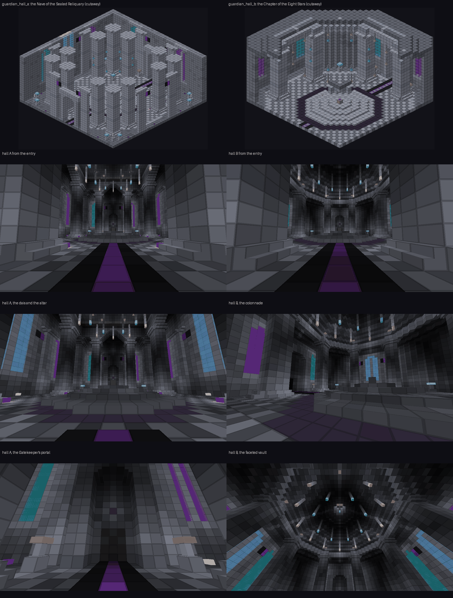
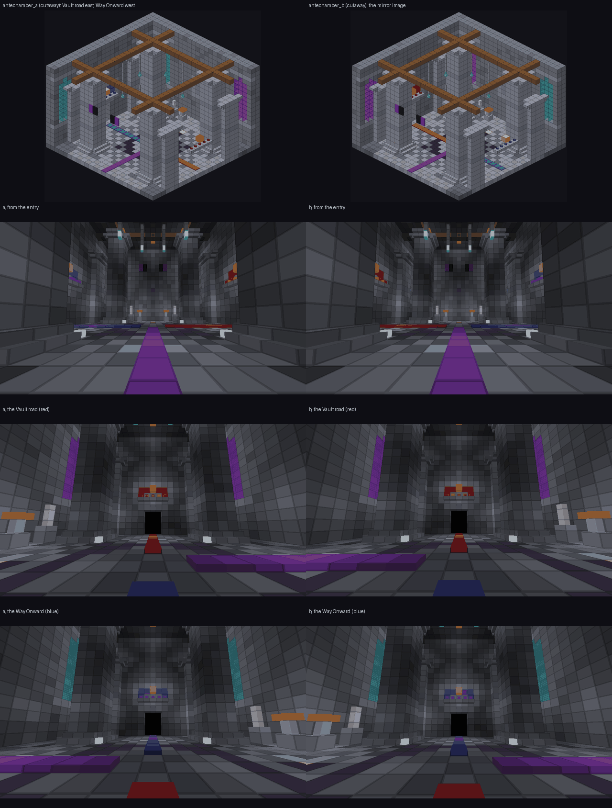
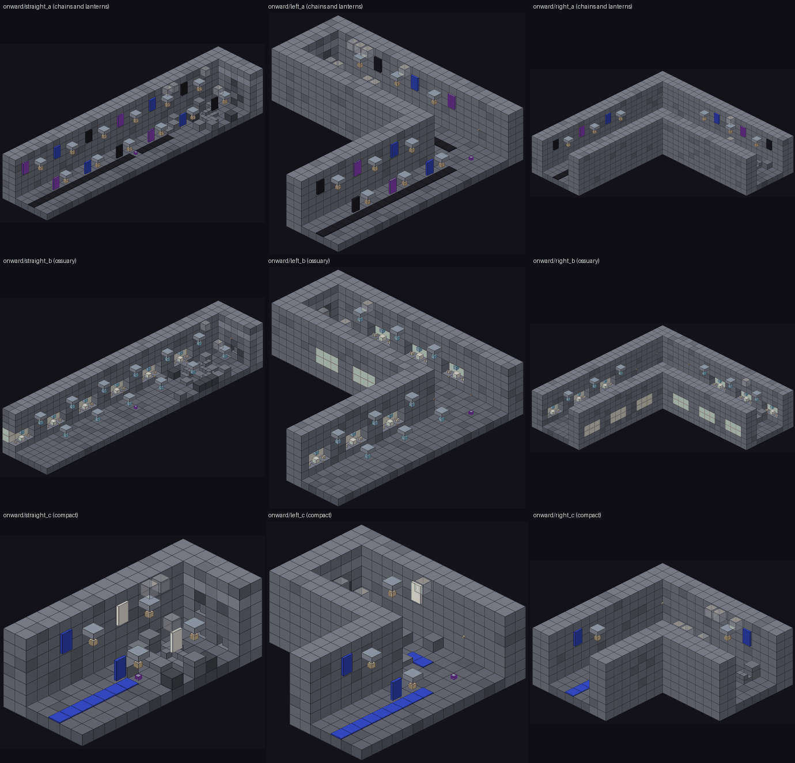
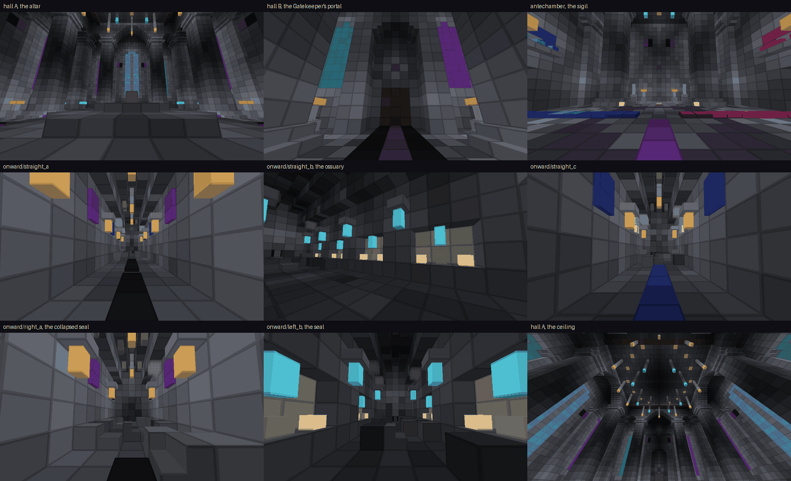
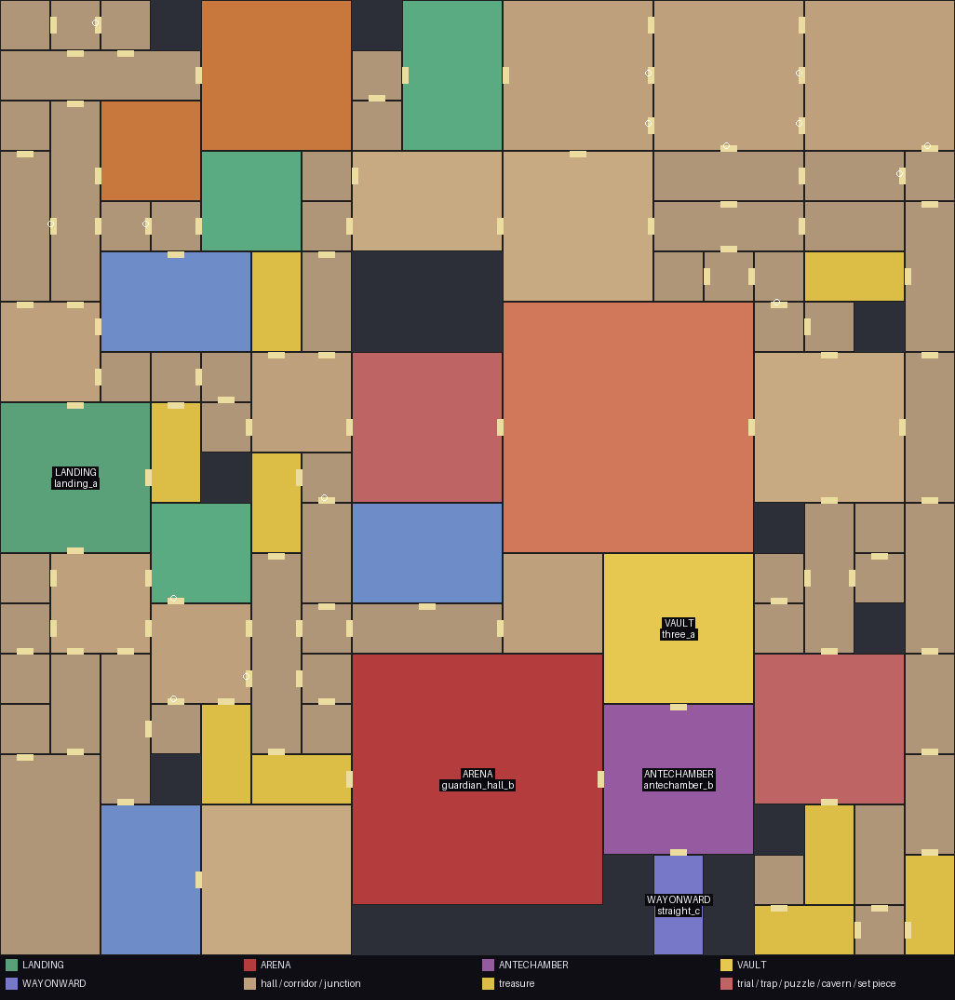
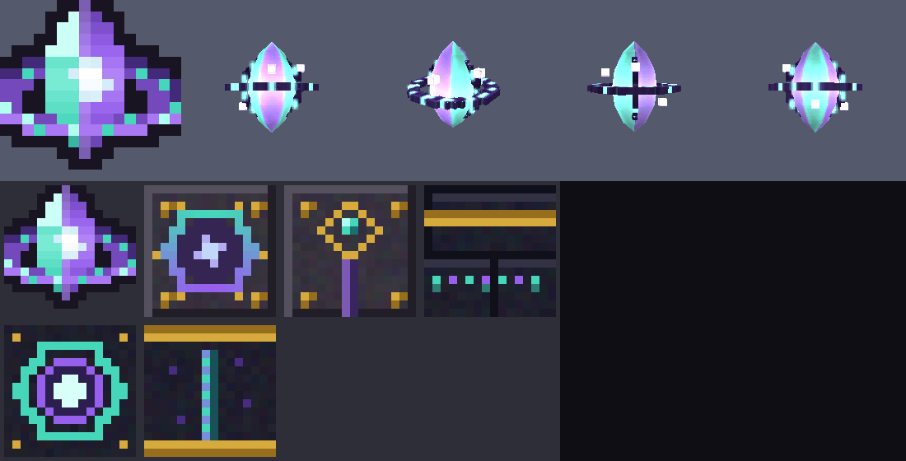

# The Labyrinth Guardian, its Altar, the Mana Core and the sector Gatekeeper (builder GUARD, 1.54.0, with the 1.55.0 follow-ups)

Part of the Singular, Expanding Mega-Dungeon (`docs/labyrinth/mega.md`). This file says WHY each class, template and file of the guard builder exists, how the
state machines work, what the numbers are, and, honestly, what has never been run. Nothing here was played: the author had no game and no whole-project compiler.
What stands behind it is listed in section 9; the pictures of every template are in section 11 and under `docs/labyrinth/mega_guard/`.

The sector's story in four sentences: the Guardian Altar in the middle of the Guardian's hall wakes the **Labyrinth Guardian** when a survival player comes near;
when it dies the altar forges a **Mana Core** that names the sector; the core, and nothing else, opens the sector's **Gatekeeper** (a `gatekeeper_door` of
`kind=sector`) in the hall's north wall; behind it lie the **antechamber** with its two roads (the Crucible Vault and the **Way Onward**), and the Way Onward ends in
a rubble seal where the next sector is attached.

---------------------------------------------------------------------------------------------------------------------------------------------

## 1. New, replacement, kept (rule 5)

| Part | Status |
|---|---|
| `GatekeeperDoorBlock.Kind.SECTOR` (+ two short branches), `blockstates/gatekeeper_door.json` four variants | NEW, appended; the three older kinds (warden, boss, puzzle) behave byte for byte as before |
| `FloorWardenEntity`: three protected hooks (`slamDamage`, `slamRadius`, `onGroundSlam`) and the `nusmp_servant` tag on the Armors it summons | NEW, additive; a Floor Warden slams, summons and drops exactly as before |
| Mana Core item, `SectorCore` data component, sprite, 3D in-hand model, class table and Better Combat entries | NEW |
| Labyrinth Guardian entity, Guardian Altar block / block entity / item, `GuardianScaling`, traits, config, command, self-tests | NEW |
| `arena/guardian_hall_{a,b}`, `antechamber/antechamber_a`, `onward/{straight,left,right}_{a,b}` | NEW (nothing like them existed; the Spire's Peak Altar room stays registered) |
| `antechamber/antechamber_b` (the mirror image of `a`) and `onward/{straight,left,right}_c` (compact corridors, 9 x 18 and 18 x 18) | NEW in the relaunch; ADDED next to the first nine (nothing replaced). The assembler places no boss chain with the first nine alone: section 10 |
| 1.55.0 follow-ups: the `nusmp_sector_guardian` tag and the `nusmp_sector` key, the colossal `SCALE` (config range 0.5 to 4), the boss bar naming the floor, the party credit at the door | NEW, small additions to the entity, the config and the door (sections 2 and 3) |
| Light of the templates (invisible `minecraft:light` blocks, braziers, votive candles) | NEW: every template reaches block light 6 at eye height everywhere a player can stand (section 5) |
| `WeaponRenderer.BASE_WEAPONS` | one entry appended (the Mana Core) |
| Replacements | NONE. Nothing was removed. |

---------------------------------------------------------------------------------------------------------------------------------------------

## 2. The numbers (`GuardianScaling`, `GuardConfig`)

| What | Formula | Config key (file `nusmp-labyrinth-mega-guard-server.toml`, section `[guard]`) |
|---|---|---|
| Health | `guardianBaseHealth * (1 + threatHealthScale * (threat - 1))`, the attribute stops at 1024, the rest is a damage divisor | `guardianBaseHealth` 400 (20..5000), `threatHealthScale` 0.35 |
| Melee damage | `14 * (1 + threatDamageScale * (threat - 1))`, at most 150 | `threatDamageScale` 0.12 |
| Armour | `12 + 0.75 * (threat - 1)`, at most 30 | (fixed) |
| **Size (colossal)** | `Attributes.SCALE = guardianScale * min(1.25, 1 + 0.02 * (threat - 1))`, never above 4 | `guardianScale` **1.8** (0.5..4.0; 1.0 is a Floor Warden's size) |
| Approach | a survival player this close (blocks) wakes it; the fight is abandoned when nobody is within this + 16 for `abandonSeconds` | `approachRadius` 16 (6..48), `abandonSeconds` 120 (20..1800) |
| Re-forge | minutes after a forge before a lost core may be forged again | `reforgeMinutes` 5 (0..120) |
| Switches | the nine theme traits, the leash to the hall | `traits` true, `leash` true |

`threat` is `Sector.threat` (how it is computed per road is the lead's business). The Guardian is a Floor Warden with the SCALE attribute raised, so the **hitbox**
grows by itself (`LivingEntity.getDimensions` is final and multiplies the type's 1.4 x 3.2 by the attribute: 2.5 x 5.8 at the default) and so does the **model**:
`LivingEntityRenderer.render` applies `entity.getScale()` before it calls the renderer's own `scale()` hook, where `FloorWardenRenderer` has its fixed 1.75, so
the two multiply (1.75 x 1.8). No renderer change is needed. The Ground Slam radius is `4 * scale` blocks (+ the gravity trait's bonus).

Keys other modules read (the owner's brief for the decennial boss): the scoreboard tag **`nusmp_sector_guardian`** and the persistent-data int **`nusmp_sector`**
(the sector id, -1 for a test Guardian that belongs to none). Both are written at construction, when the Guardian is configured and when it is loaded. The two older
tags stay (`nusmp_peak_boss` keeps the economy, the HP buffer and Vital Strike off it; `nusmp_mega_guardian` is ours). The Guardian is NOT tagged
`nusmp_wanderer` (`GenesisCoreDrops.isDungeonBoss` ignores wanderers; this is a boss-room boss, and `nusmp_peak_boss` makes it count as one, so the people who
fought it are eligible for a Genesis Core like at any other dungeon boss).

**The boss bar** names the floor the hall is the last of: the arena is the last floor of its sector, so the custom name the Warden's bar shows is
`entity.nusmp.labyrinth_guardian.bar_floor` with the signed floor from `FloorMap.label(Sector.lastFloor())` and the theme: "Floor +10 Warden (Frost)" on the
Holy road, "Floor -10 Warden (Abyss)" on the Abyssal one. A Guardian that belongs to no sector (a test Guardian) has no floor to name and shows
`entity.nusmp.labyrinth_guardian.bar` ("Labyrinth Guardian (Gravity)"). The title is saved with the entity, so a reload keeps it.

**Traits** (one per theme; the two roads of 1.55.0 borrow: `radiant` has ASTRAL, `abyss` has GRAVITY). Each is five numbers (cooldown, range, power, duration, count),
the second phase (under half health) multiplies cooldown by 0.7, range by 1.2, power by 1.4 and adds to the count, and hard caps clamp the result (all tested):
GRAVITY a well that pulls players 3..10 blocks away in and slows them; BLOOD an absorption shield fed by its own hits (the brief said "lifesteal", but the boss rules
drop every heal in combat, so it is a shield, never health: a documented deviation); SPATIAL a blink behind its target (never into a wall, never out of the hall,
at most every 5 s); FLAME a fire trail of damage cells and fire immunity (no block is ever changed); FROST a slowing aura; VERDANT a one-second root through
`BalanceLaw.beginControl`; STORM chain lightning after each Ground Slam; SHADOW a darkness pulse (blindness at most 2 s, only within 6 blocks); ASTRAL a ring of
falling stars (damage only, no push).

---------------------------------------------------------------------------------------------------------------------------------------------

## 3. Classes (package `labyrinth/mega/guard`) and WHY

| Class | Why it exists |
|---|---|
| `GuardianScaling` (pure) | Every curve, the trait table, the caps and the re-forge rule in one place with no Minecraft types, so JUnit pins them and a mutation check proves the tests bite. |
| `TraitMath` (pure) | The geometry of the traits (blink spots behind a target, chain order and decay, the star ring, the fire trail's cell book) so it is testable. |
| `AltarRules` (pure) | The altar's decisions (summon, finish, reset) as one function of what the block entity sees. A boss that VANISHED is a reset, never a victory: finishing forges a core and unseals a sector, which must only follow a real death. |
| `SectorDoorRules` (pure) | The five answers of the door to a core (open, dormant, not here, wrong sector, not ready). |
| `CoreHint` (pure) | The compass for the Mana Core's right-click (eight directions, rounded distance). |
| `GuardConfig` | The `[guard]` config with a `get()` that answers defaults while the spec is not loaded. |
| `SectorCore` | The data component `{sector, theme}` (codec and stream codec) that makes one core the key of one sector. |
| `ManaCoreItem` | The key: epic, foil, never despawns, invulnerable, glowing, rescued from the void by its sector's altar, tooltip in the theme's colour, a compass on right click. |
| `SectorDoor` | The whole behaviour of `kind=sector`, kept out of `GatekeeperDoorBlock`: Shadow Key refused, a core checked by `SectorDoorRules`, the 24-block slab opened by the existing flood (inside the Dungeon Guard's internal span, which `openConnected` already does: the Mega-Dungeon is a guarded dimension), the core spent (not in creative), `mega.sector_cleared` fired for the clicker AND every living player within 32 blocks of the door (`NusmpEvents.fireAll`, with the squad sharing it adds), `MegaDungeon.unseal` called. |
| `LabyrinthGuardianEntity` | The boss: a Floor Warden that scales, has a theme trait, obeys the boss rules (`BudgetedBoss`, no heals), is leashed to its hall, drops nothing, is colossal and carries the two keys above. |
| `GuardianTraits` | What the nine traits do in the world; players only, no block ever changed, hard control through `BalanceLaw`. |
| `GuardianAltarBlock` / `GuardianAltarBlockEntity` | The altar and its three-state machine (below); forges the core; re-forges a lost one. |
| `GuardCommand` | `core give <player> [sector]`, `core forge`, `core guardian` (the lead attaches it under `/multiverse mega`). |
| `GuardRegistry` | Blocks, block entity, entity type and attributes, items, the data component; one game-bus handler that makes every Mana Core item entity indestructible the moment it exists. |
| `GuardLog` | Every entry point that runs inside the server's own loops (the altar's ticker and click, the Guardian's `aiStep`, the Mana Core's item-entity update and right click, the join handler, the call into `MegaDungeon.unseal`) catches `RuntimeException` and reports it here: the first three failures of each place are logged with their stack, the rest stay quiet. During a self-test `GuardLog.strict` is set and the failure is rethrown, so a swallowed error fails the test. |
| `GuardSelfTests` | The in-game self-tests (section 7). |

**The altar's state machine** (saved in NBT; polled every 10 ticks on the server):
`IDLE` (a survival player within `approachRadius` and the sector not GENERATING/FAILED -> builds the Guardian for the sector under it, `ACTIVE`) ->
`ACTIVE` (the Guardian told the altar it died, or the altar sees it dead -> `DONE`; the party stayed away for `abandonSeconds`, or the Guardian vanished without dying
-> back to `IDLE`) -> `DONE` (forged one Mana Core of the sector above itself, called `MegaDungeon.guardianDefeated`; a click with an empty hand re-forges a lost core
while the sector is still GUARDIAN_DEAD, no core of the sector exists within 64 blocks or in an online player's pack, and `reforgeMinutes` passed). The state machine never
depends on the sector's state: an altar in a sector that is not ACTIVE (an admin test, a regenerated sector) works the same way, and `guardianDefeated` itself ignores it.

**The door** (`kind=sector`): a closed slab of 3 x 4 x 2 = 24 blocks (rows 9-10 lower half, 11-12 upper half, both wall layers). Right click with a core of the sector that holds
the door and the sector not GENERATING/FAILED: the flood (`DoorFlood`, limit 64) opens all 24, the core is spent, `mega.sector_cleared` (argument: the sector id) is fired, the
sound and particles play, `MegaDungeon.unseal` raises the expansion level and asks the generator. The Shadow Key is refused with a message; a blank core, a core of another
sector and an empty hand do nothing. Redstone, pistons and explosions can do nothing: the block is unbreakable, pushes nothing and the Dungeon Guard holds the dimension.

---------------------------------------------------------------------------------------------------------------------------------------------

## 4. The Mana Core's look (the owner's rule: a real 3D model, the sprite stays the inventory icon)

`tools/labyrinth/gen_mega_items.py` draws the 16 x 16 sprite (a glowing teal-violet crystal in a ring of runes), the block textures of the sector door (a 16 x 64 animated
strip for the lower half, 16 x 16 for the upper half, both with the sector's own look), the altar textures (side, top, pillar) and every model JSON, and merges the four
`kind=sector` states into `blockstates/gatekeeper_door.json` (additions only). `tools/gen_weapon_models.py` gained `mana_core` (a lathe-turned hex crystal, a horizontal and a
vertical ring of runes, four glowing motes), appended to `RELICS` right after the hourglass; the mesh, body and glow skins are generated into `assets/nusmp/weapon_meshes`
and `textures/entity/weapon`, the 128 px sources into `tools/weapon_tex_128`. The item is class `handitem` in both copies of `weapon_classes.json` (so the size rule treats it as a
hand item), excluded from Better Combat in `tools/bettercombat/manifest.json` (regenerated by `tools/bettercombat/inventory.py`), and listed in `WeaponRenderer.BASE_WEAPONS`
(without that the held model is never drawn; `GuardAssetsTest` pins it).
Preview without the game: `python tools/item_preview/preview_weapons.py mana_core` (writes `build/item_preview/weapons.png`: the old sprite, then the held model from the front, three quarters, edge on and from behind).

**The Guardian Altar's look** (the brief asked for a taller plinth with four rune pillars, different from the Peak Altar). The model is seven boxes: a 16 x 4 x 16 base slab, a 10 x 5 x 10 plinth, a 6 x 4 x 6 crown and four 3 x 12 x 3
rune pillars standing on the corners of the base (the collision shape in `GuardianAltarBlock` is the same silhouette). The Peak Altar's textures are not reused: `gen_mega_items.py` draws three new ones with the mana palette of the
door and the core (teal and violet on dark deepslate, gold trim): the side (dark bricks, a gold line, a band of rune dots), the top (a teal hexagon round a violet ring and a bright heart, the place the Guardian rises from) and the pillar
(a thread of runes between gold collars). The sector door's closed faces use the same palette (an animated hexagonal socket on the lower half, a gold lattice with a violet chain on the upper), so a player reads door, altar and core
as three parts of one lock. A contact sheet of the six textures: `python3 tools/labyrinth/gen_mega_items.py --sheet sheet.png`.

---------------------------------------------------------------------------------------------------------------------------------------------

## 5. The templates (`tools/labyrinth/gen_mega_guard.py`, helpers in `tools/labyrinth/mega_guard_lib.py`)

Thirteen templates, all built with `mega_lib.MT` and deterministic (`gen_mega_guard.py --check` rebuilds every one in memory and compares bytes with the files).
Vanilla blocks only, except the two the contract allows: `nusmp:guardian_altar` and `nusmp:gatekeeper_door` (no other custom block: the lights are vanilla
`minecraft:light` blocks, the braziers campfires, the statues armor stands). Architecture uses the palette (deepslate and dark oak families), so the Region Theme
restyles it. A template is finished only when it passes four gates: the generator's own `verify` (below), `python3 tools/labyrinth/mega_check.py` (0 errors in
these thirteen; the only errors left in a worktree are the empty pools, which `gen_mega_pools.py` fills from the folders: on a scratch copy of the tree with the pools generated and the other builders' templates merged in, the whole
checker said `103 templates, 15 pools, 0 errors, 2 warnings`, and the two warnings, blackstone outside the palette in a Landing and a hearth hall, are not this builder's), `python3 tools/labyrinth/mega_arch_check.py`
(0 problems: the game's survival rules for lanterns, candles, banners, chains, carpets, water, armour stands) and the light report (section 5.2). The second audit of the ROOMS-2 tools,
`mega_decor_r2.attachment_problem` over every block of every template, also finds nothing.

### 5.1 The thirteen

| Template | Size | Sockets | Markers | Look |
|---|---|---|---|---|
| `arena/guardian_hall_a` "The Nave of the Sealed Reliquary" | 45 x 45 | south offset 22 `mega_door`, pool `minecraft:empty`, open; north offset 22 `mega_chain`, pool `mega/antechamber`, final state the door block, the 3 x 4 x 2 hole filled with the Gatekeeper slab | `guardian_spawn` above the altar (22,12,22), `gatekeeper` (22,10,2) facing north; no spawn or patrol marker | A square nave 26 rows high ringed by twelve columns with flared capitals and a stepped arcade, lit lancet windows (stained glass over sea lanterns), a three-tier dais with the altar, a crying-obsidian rune ring, a chequerboard floor, a halo of soul lanterns, portal porches round both doorways. Light: a pair of soul fires beside each corner statue, a warm fire either side of the Gatekeeper and of the entry, a row of votive candles along the foot of every wall, eight glowing floor nodes. |
| `arena/guardian_hall_b` "The Chapter of the Eight Stars" | 45 x 45 | same as A | same as A | The same contract in an octagon (the footprint's corners cut off), eight columns on a ring of radius 16 **turned half a step so that no column stands in the axis of a doorway** (the first version had one in front of the entry and one in front of the Gatekeeper, and the carpet ran into its foot), joined by a lintel, octagonal rings in the floor, a stepped faceted vault rising to a lantern shaft with a hanging soul-lantern cluster, a warm fire either side of both doors. |
| `antechamber/antechamber_a` "The Hall of the Two Roads" | 27 x 27 | south offset 13 `mega_chain` (pool empty, open); east offset 13 `mega_vault` (pool `mega/vault`); west offset 13 `mega_onward` (pool `mega/onward`) | one `patrol` | A calm lobby: sigil floor, four columns and a beam grid, two armoured statues, braziers, a red wool-and-candle plaque over the Vault road and a blue one over the Way Onward, a red carpet to the one door, a blue to the other. |
| `antechamber/antechamber_b` | 27 x 27 | the same three, with the roads swapped: vault WEST, onward EAST | one `patrol` | The mirror image of `a` (plaques, carpets and window colours follow the sides). **Why it exists:** the assembler cannot flip a template, so with `a` alone the Way Onward always leaves on the left of the chain; where that flank is shut in by the edge of the region the chain does not fit, and the mirror does (section 10). |
| `onward/straight_{a,b}` | 9 x 36 | entry south offset 4 `mega_onward`; sealed end north offset 4 `mega_door`, final state `cobbled_deepslate` | `patrol`; `expansion_socket` (facing north, w=3 h=4 d=2) directly above the end jigsaw | A 5-wide vaulted corridor. `a`: chains, lanterns on slab brackets, banners, a black runner, a collapsed end (rubble, patched roof, stalactites, cobwebs). `b`: an ossuary (skull niches with candles, soul lanterns hanging over the skulls, bone). |
| `onward/straight_c` | 9 x 18 | the same | the same | `a`'s passage in compact size under blue banners over a blue runner (the colour of the Way Onward's plaque). |
| `onward/right_{a,b}` | 27 x 27 | entry south offset 4; end EAST offset 4 | same, facing east | The L: north along the west module column, then east along the north row. |
| `onward/right_c` | 18 x 18 | the same | the same | The compact L. |
| `onward/left_{a,b}` | 27 x 27 | entry south offset **22**; end WEST offset 4 | same, facing west | The mirror image (the entry is on the east side so the corridor can turn west; the brief said offset 4 for all, which cannot turn west). |
| `onward/left_c` | 18 x 18 | entry south offset **13**; end west offset 4 | same | The compact left turn. |

The expansion marker stands in the outer layer of the seal, row 10, so that one cell is a dimple in the rubble until the generator clears the seal (a structure block is never placed).
**Why three sizes of Way Onward:** the corridor leaves the antechamber at the side of the chain, and a region that is nearly used up on that side takes only a short one. The pools offer all
of them and the assembler tries the entries in weighted order and keeps the first that fits, so a compact corridor costs nothing where a long one fits and makes the chain placeable where it does not (section 10).

`mega_guard_lib.py` also holds the checks a game would have done for us, run by the generator on every build (it fails the build when one fails): a flood fill that proves every room is
closed except through its declared open doorways (no gap in a wall, floor or roof; the octagon's void corners never touch the hall), that every open doorway is reachable from
inside, that the 24-block slab and its states are right, that the altar has nine free cells above it (the colossal Guardian), that the markers and their arguments are what the
Java reads, and that a clear 3 x 11 lane of floor with eight free rows exists (the trait self-test needs one). An invisible light block counts as free air for these checks (it has no collision).

### 5.2 Light (the gloom clock) and the invisible lights

The dungeon's gloom clock (`labyrinth/dnd/economy/GloomClock`) counts every second a player spends at block light 4 or less with nothing lit in hand. A nave 26 rows high cannot be
lit from its ceiling (a soul lantern hung at row 27 gives nothing at row 9), so the first version was dark on 13 % of its floor and the middle of the dais, exactly where the party fights, was
black. Two things fix it. The visible fixtures are placed for their looks (braziers, votive candles, lanterns on slab brackets, floor nodes); then `mega_guard_lib.ensure_light` covers
what is still dark with vanilla `minecraft:light` blocks (level 12 to 13, three cells above a standing cell, so above a player's head and with no collision), greedily and deterministically,
using the preview tool's own light model (`mega_shape_preview.light_field` / `standable_cells`), until every standable cell reaches 6 at eye height (the gloom limit is 4, the model is a little
optimistic about stairs and slabs). The Guardian Altar's own light (level 12, `GuardRegistry`) is part of the picture; the preview tool does not know it, so the numbers below were measured with
`tools/labyrinth/mega_shape_preview.py` plus the one line `LIGHT_FIXED["guardian_altar"] = 12`.

| Template | invisible lights | minimum | mean | share at 4 or less | share at 7 or less |
|---|---|---|---|---|---|
| `arena/guardian_hall_a` | 36 | 6 | 8.9 | 0.0 % | 13.9 % |
| `arena/guardian_hall_b` | 19 | 6 | 8.8 | 0.0 % | 17.4 % |
| `antechamber/antechamber_a`, `_b` | 6 | 6 | 9.1 | 0.0 % | 13.4 % |
| `onward/straight_a` / `_b` / `_c` | 0 / 6 / 0 | 8 / 6 / 7 | 11.0 / 8.1 / 10.6 | 0.0 % | 0 / 21 / 4 % |
| `onward/left_a` / `_b` / `_c` | 1 / 9 / 1 | 7 / 6 / 7 | 10.5 / 8.2 / 9.6 | 0.0 % | 3 / 20 / 11 % |
| `onward/right_a` / `_b` / `_c` | 1 / 10 / 1 | 6 / 6 / 6 | 10.4 / 8.2 / 9.7 | 0.0 % | 5 / 19 / 13 % |

Before the pass the same measurements were: hall A minimum 0 and 13.0 % at 4 or less, hall B 5.7 %, ossuary corridors up to 14.5 %.

### 5.3 What the architecture checker found (and what was fixed)

`mega_arch_check.py` (added to the shared tools after the first version of these templates) flagged 108 defects in the six first Way Onward corridors: every sconce was a lantern hanging from an
**upside-down stair** (a stair's step does not cover the middle of the cell, so the game would drop the lantern), and every ossuary niche stood a soul lantern **on a skull** (a skull's top is not
a full face). Fixed: the sconce bracket is a bottom slab (its underside is a full face) and the niche lantern hangs from the wall block above the skull. All thirteen templates now report 0 problems.

---------------------------------------------------------------------------------------------------------------------------------------------

## 6. Commands and quest keys

`/multiverse mega core give <player> [sector]` (a core of the named sector, else of the sector the player stands in, else of the newest), `core forge` (the nearest loaded altar
forges a core now, no rules), `core guardian` (a test Guardian at your feet: no altar, so no leash, no core, nothing it does can unseal a sector). Permission 2.
Quest key fired: `mega.sector_cleared` (argument: the sector id), by the door, once per opening, for the player who opened it and every living player within 32 blocks of the door
(`NusmpEvents.fireAll`, so the squad sharing of the quest system adds the members who stand near). **A note for `docs/quests.md`:** its row for this key says "the Labyrinth Guardian of a sector dies";
the brief of this builder puts the hook at the Gatekeeper, so the key fires when the seal is broken, which is when a sector is *cleared*. The advancement "Sector Cleared" and its
three-sector successor read the same key either way; if the lead prefers the moment of the Guardian's death, the hook moves to `GuardianAltarBlockEntity.finish` (one line, and the door stops firing it: never both,
or "three sectors" would count 1.5).

---------------------------------------------------------------------------------------------------------------------------------------------

## 7. In-game self-tests (`/multiverse mega selftest [key]`, run by the CI smoke test)

Registered from `GuardRegistry.init`, all against the REAL sector 0 the smoke test generates: `guard.registry` (everything registered, the component survives the stack and network codecs),
`guard.altar` (one arena, an antechamber, a Way Onward, the altar block and its block entity inside the arena, eight clear cells above it, the 24-block slab next to the GATEKEEPER marker,
both markers, the expansion landmark), `guard.approach` (the altar sleeps for a person outside the radius, a creative one and a spectator, and wakes the Guardian, bound to the sector and the
altar, for a survival one inside), `guard.spawn` (bound to the sector, the formula's health, the config's colossal size and a hitbox that followed it, the three tags and the sector key, a
title naming the floor, a save-and-reload that keeps all of it, the boss rules on, a blow of a million taking only a sliver), `guard.traits` (all nine traits run against a person and do what
they say), `guard.core` (a confirmed death makes exactly one core of the sector, indestructible and glowing; a second death makes none), `guard.gatekeeper` (the door refuses an empty hand, the
Shadow Key, a blank core and another sector's core, and opens to its own: 24 blocks, the core spent, the sector UNSEALED) and `guard.idempotent` (a core on an open door does nothing, a second
core on the re-closed door never unseals twice).

How they stay safe: each test snapshots what it will change (the altar's NBT, the sector's state and the expansion level, the door slab, the Expander) and restores it in a `finally`; it only
removes the entities it made; **the Expander is replaced by a recording spy while a door is clicked, so no real sector is generated** (`MegaDungeon.unseal` calls `Expander.requestNext`
synchronously inside the click, the spy records it, the real one is asked nothing; the tests accept 0 or 1 calls so a later change that defers growth until the Crucible does not break them).
What they cannot undo is the other systems' reaction to `guardianDefeated` and `unsealed`: run them on a throw-away world.

**Why the tests do not use `SelfTests.player` (the FakePlayer).** A FakePlayer is a `ServerPlayer` with no connection: the first potion effect given to it calls `connection.send` and throws, and
the traits exist to give effects. It is also in no level's player list, so nothing that scans `level.players()` (the altar's approach check, the Guardian's aggro) ever sees it. The tests use a plain
`Player` subclass (`GuardSelfTests.Dummy`: invulnerable, survival, never added to a level) and two seams that are `null` outside a test: `GuardianTraits.testPlayers` and
`GuardianAltarBlockEntity.testPlayers`. The door is simply handed the Dummy as the clicking player.

Pure tests (no game): `GuardianScalingTest`, `TraitMathTest`, `AltarRulesTest`, `SectorDoorRulesTest`, `CoreHintTest`, `GuardAssetsTest` (the resource files: door states and models, the
altar, the Mana Core's icon, mesh, skins, class table, Better Combat exclusion and the renderer list) and `GuardCatalogTest` (the thirteen templates as the REAL catalog describes them: sizes, the
arena's two sockets and the Gatekeeper final state, its two markers, the antechamber's three sockets with the roads on opposite flanks, every Way Onward's sealed end with the expansion marker
directly above it facing the way the next sector attaches, and the file-name prefix of each corridor against the face it ends on; it checks nothing while the catalog was not rebuilt after the
templates were added, and fails when only some of the thirteen are there). Mutation checks done: removing the SHADOW range cap, turning the vanished-boss reset into a
victory, removing the size growth cap, and mapping `radiant` to the wrong trait were each caught by a test; so were a missing class-table entry and a missing door model; and three deliberate faults in a
copy of the catalog (an expansion marker one cell too low, a moved Gatekeeper marker, a left corridor that enters on the wrong side) were each caught by `GuardCatalogTest`.

---------------------------------------------------------------------------------------------------------------------------------------------

## 8. Integration (what the lead does; the same lines are in the builder's report)

1. Config, in `NUSMP.java`: `modContainer.registerConfig(ModConfig.Type.SERVER, com.newuniverse.nusmp.labyrinth.mega.guard.GuardConfig.SPEC, "nusmp-labyrinth-mega-guard-server.toml");`
2. Command, under `/multiverse mega`: `mega.then(com.newuniverse.nusmp.labyrinth.mega.guard.GuardCommand.command());` (the literal is `core`).
3. The Guardian's renderer is the Warden's, in `client/labyrinth/seal/SealClient.registerRenderers`: `e.registerEntityRenderer(com.newuniverse.nusmp.labyrinth.mega.guard.GuardRegistry.GUARDIAN.get(), FloorWardenRenderer::new);`
4. Creative tab, `LabyrinthCreative.IDS`: append `"mana_core", "guardian_altar"` after `"relic_forge"`.
5. Language file: `python3 $S/mega/merge_frags.py` merges `mega/frag/mgd.lang.json` (48 keys: the block, entity and item names, the boss bar titles, the tooltip and message lines, the nine theme names).
6. The pools and the catalog are derived data: `python3 tools/labyrinth/gen_mega_pools.py && python3 tools/labyrinth/mega_catalog.py` after the merge (they give `arena`, `antechamber`, `onward` and the three
   `onward_*` pools their templates from the folders and the `straight_` / `left_` / `right_` file-name prefixes, which `mega_pools.json` already knows; `GuardCatalogTest` then checks the thirteen).
7. The shared tool `mega_lib.py` already lists `nusmp:.*` before the vanilla `.*_door` rule, so the Gatekeeper door passes the state check (the first version of this document asked for that line).
8. Entity attributes are registered by `GuardRegistry.init` on the mod bus; nothing to add. `GuardRegistry` must be initialised before `NUItems.ITEMS` is handed to the bus: `MegaSystem.init` runs at the end of `LabyrinthSystem.init`, which guarantees it.

Shared files this builder edited (everything else is in new files): `labyrinth/seal/GatekeeperDoorBlock.java` (the enum entry `SECTOR("sector")`, one `if` at the top of `useItemOn` and one `else if` in `useWithoutItem`;
the three older kinds behave exactly as before), `labyrinth/seal/FloorWardenEntity.java` (three protected hooks `slamDamage()`, `slamRadius()`, `onGroundSlam(ServerLevel)` that the Warden itself leaves at 8, 4 and nothing, and the
`nusmp_servant` tag on the two Living Armors it summons), `client/WeaponRenderer.java` (the Mana Core appended to `BASE_WEAPONS`), `assets/nusmp/blockstates/gatekeeper_door.json` (four variants appended),
`assets/nusmp/weapon_classes.json` and `tools/relics/weapon_classes.json` (the Mana Core is a `handitem`), `tools/bettercombat/manifest.json` (excluded: a key has no swing) and `tools/gen_weapon_models.py` (the `mana_core`
builder appended to `RELICS`).

---------------------------------------------------------------------------------------------------------------------------------------------

## 9. Not verified (honest list)

Nothing ran in the game. Checked: every Minecraft/NeoForge call against the API dump (the classes the dump does not contain are listed in the builder's report, with where the repo already calls them), the whole guard
package and the two shared classes it touches against the API stubs with a negative control (the 17 errors left in these files are the known stub artifacts: `new BlockPos(int,int,int)`, `new ItemEntity(...)`,
`new MobEffectInstance(...)` reported as "abstract", `Direction.getAxis()`, and the stubs' missing implementation of `INBTSerializable` on `Player`), 49 pure tests, the thirteen templates by the generator's own checks, by
`mega_check.py`, by `mega_arch_check.py` and by the light report, the whole boss chain against the CORE builder's work-in-progress assembler (section 10), and the existing pure tests that read the shared files this
builder touched (`WeaponAttributesTest`, `WeaponMeshesTest`, `RelicRenderCoverageTest`, `RelicHandCoverageTest`: all pass). The whole test suite was NOT run (a local run with the tiny JUnit shim cannot compile the tests that reach Minecraft classes).
Never run: the altar's ticker and spawn, the colossal hitbox and model together, the entity's attributes registration, the Mana Core as an item entity (void rescue, glow), the sector door's
click path with a real `ServerPlayer`, the traits against real players (the tests use a stand-in), the in-hand model, every template as placed by the generator (the chain socket's jigsaw
final state becoming the door block, the clear of the seal, rotation of the markers' `facing`), the light the real engine computes (the model is a little optimistic through stairs and slabs), the look of anything
beyond what a coloured voxel preview shows, and the whole of `GuardSelfTests` (written to be read in a CI log: a failing line says what it expected).

---------------------------------------------------------------------------------------------------------------------------------------------

## 10. How the chain fits the assembler (measured, and why there are thirteen templates)

The CORE builder's work-in-progress assembler (`labyrinth/mega/gen`, pure Java, the simulator `MegaSim`) was run over a scratch copy of the tree with the real catalog: these templates, the vault rooms of the THEME
builder (work in progress), the Landings, halls, caves and traps already merged, and the treasure closets of ROOMS-1. Forty seeds (150 for the last two rows), up to 25 tries each:

| Boss chain offered | Sectors that passed the audit | Needed the fallback layout (7 pieces) | Average tries per sector |
|---|---|---|---|
| the first nine templates (`a` and `b` only) | 0 of 40 | 40 | 25 (every try failed) |
| + the three compact corridors `*_c` | 150 of 150 | 0 | 3.25 |
| + the mirrored antechamber alone | 0 of 40 | 40 | 25 |
| + both (the thirteen) | 150 of 150 | 0 | 1.97 |

The reason is geometry. The arena has one entry (the brief: a dead end), so the chain runs straight away from the door it hangs from, and the Vault road and the Way Onward leave the antechamber at its two flanks. The doors
the first fill leaves on the boundary of the reserved band were all near the two lateral edges of the region (|z| from 54 to 81 of 85), where only 18 blocks remain beside the antechamber: a 9 x 36 corridor or a 27 x 27
turn does not fit there, a 9 x 18 straight or an 18 x 18 turn does. The mirror image gives the search the other side as well, which brings the average from 3.25 tries per sector to 1.97. With the real catalog the failures that remain are other
builders' (a missing room kind), not the boss chain's. This was measured on work in progress: when the assembler changes, run `MegaSim <catalog.json> 150` again
(`src/test/java/.../mega/gen/MegaSim.java`, after `python3 tools/labyrinth/gen_mega_pools.py && python3 tools/labyrinth/mega_catalog.py`).

---------------------------------------------------------------------------------------------------------------------------------------------

## 11. Pictures (the owner asked to watch the dungeon grow)

These are renders of the templates by the repository's own preview tools, not screenshots: `tools/labyrinth/mega_shape_preview.py` (a cutaway: the roof and the two near walls removed) and
`tools/labyrinth/mega_walk_preview.py` (first person, the standing eye height 1.62 above the floor, lit by the block-light model). Flat colours and a block grid, no textures: the real game will look different
(the Gatekeeper door and the altar show as plain boxes, the glass is flat, the light is dimmer). Nothing ran in the game.

The sector plan is one seed of the CORE builder's simulator (`MegaSim`) over the real catalog of these templates plus work-in-progress rooms of other builders (the vault is the THEME builder's `three_a`): the red 5 x 5
room is the Guardian's hall, the purple one the antechamber, the yellow one the vault and the narrow blue one the Way Onward, which ends at the edge of the region where the next sector will attach. The last picture
is the Mana Core's held model from four sides (its inventory sprite at the left) over the textures of the sector door (lower half, upper half) and the altar (side, top, pillar).

To redraw any of them: `python3 tools/labyrinth/mega_shape_preview.py mega/arena/guardian_hall_a out.png --y 8:28 --x 0:42 --z 0:42 --scale 11` and
`python3 tools/labyrinth/mega_walk_preview.py mega/arena/guardian_hall_a out.png --cam 22.5,10.6,42 --look 22.5,13,4 --fov 85 --size 960x540`.
