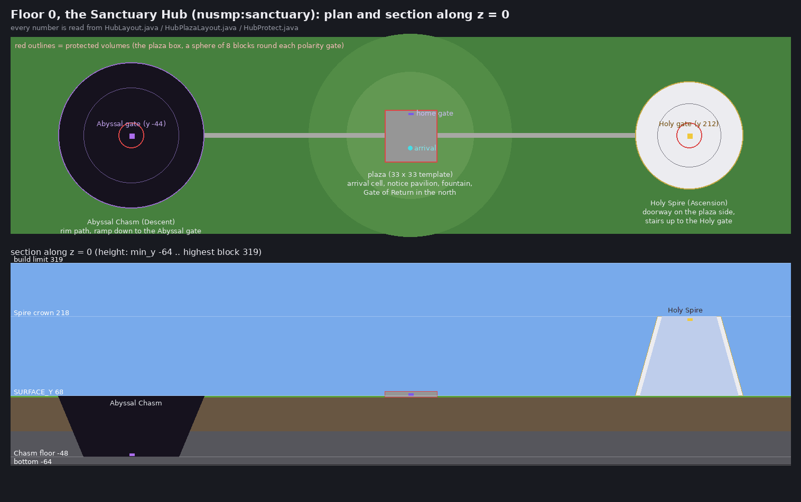
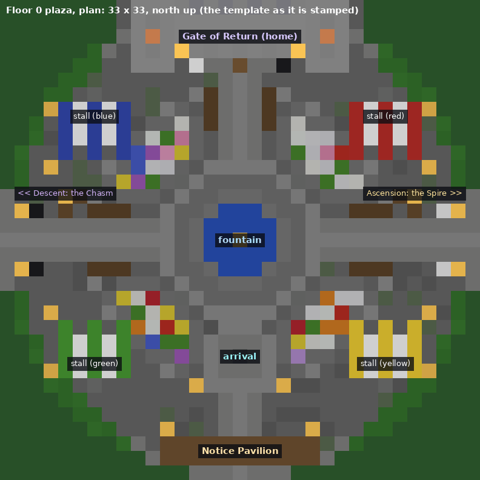
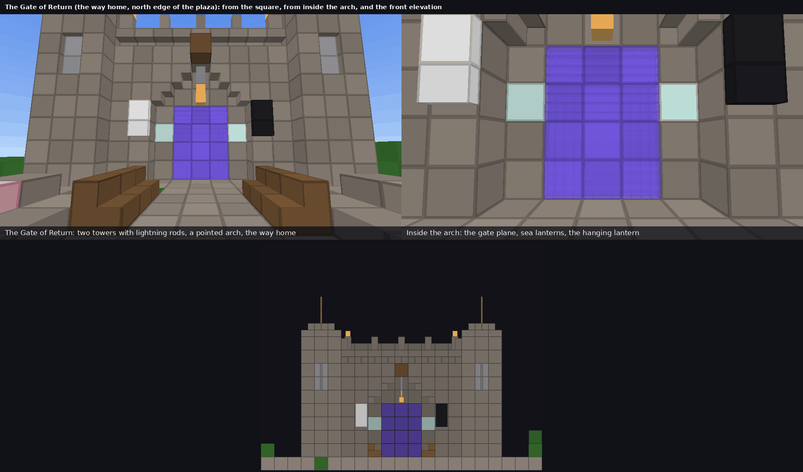
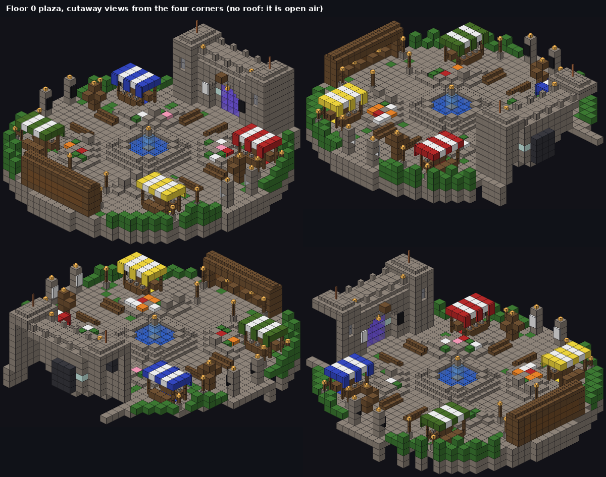

# Floor 0, the Sanctuary Hub (1.55.0, builder HUB)

Part of the bidirectional Mega-Dungeon (`docs/labyrinth/mega_floors.md`). The owner's third brief asks for a safe, buildable plains world between the Overworld
Gateway and the two roads of the dungeon: *"Floor 0: the Sanctuary Hub. The Overworld Portal: an unbreakable gateway in the Overworld that teleports players
strictly to Floor 0. Floor 0 generation: the NeoForge dimension/biome code for Floor 0 (locked to a plains biome). Sanctuary Rules: explain how to use biome
modifiers and event handlers to ensure 1) only passive mobs spawn, 2) players can break/place blocks to build a base, 3) absolutely zero structures from other
installed mods are allowed to generate here."* This builder owns the dimension data, the biome, the rules, the travel (in, across, out), the plaza and the
admin command. The terrain, the Holy Spire and the Abyssal Chasm are drawn by the MACRO builder's chunk generator (`docs/labyrinth/mega_macro.md`); the
Overworld Gateway structure is the 1.54.0 one (`nusmp:mega_gateway`), only the place its gate leads to changes.

**State of this document.** Written without a game. CI compiles the Java, runs the pure JUnit tests and the headless server smoke test (`/multiverse mega
selftest`, the six `hub.*` tests below). The plaza was checked by scripts and looked at as voxel pictures (flat colours, no textures, no sign text); section 14
lists exactly what that leaves unverified. Every class, data file and strategy below says WHY, the owner's standing requirement.



---------------------------------------------------------------------------------------------------------------------------------------------

## 1. New, replacement, kept (rule 5)

| Part | Status | Notes |
|---|---|---|
| Dimension `nusmp:sanctuary`, its type, the biome `nusmp:sanctuary_plains`, the biome modifier | NEW | Nothing like it existed. The Labyrinth (1.35.0) and the Mega-Dungeon (1.54.0) are void worlds under the Dungeon Guard; Floor 0 is the opposite. |
| Sanctuary Rules: passive mobs only, building with protected volumes, the structure alarm (`HubRules`) | NEW | The Dungeon Guard deliberately does not hold this dimension (`Labyrinth.in` is false there). |
| Travel (`HubTravel`): Overworld to Floor 0, the three gates, home, back from the dungeon | NEW, REPLACES the destination of the 1.54.0 Gateway | The old route (gate straight into sector 0) stays behind `hub.enabled = false`. The lead's three-branch routing is in section 11. |
| The plaza template `structure/hub/plaza.nbt` and its generator | NEW | The only `nusmp:` block in it is the existing `nusmp:labyrinth_gate` (the home gate). Everything else is vanilla. |
| `/multiverse mega hub ...` (tp, status, plaza, gates) | NEW | |
| Config `nusmp-labyrinth-mega-hub-server.toml` (section `[hub]`, 5 keys) | NEW | |
| In-game self-tests `hub.*` (six) | NEW | |
| `labyrinth_gate` block, `GateBlock`, `LabyrinthTravel`, `GateRules` | KEPT, not edited | The Hub's gates ARE this block; the lead routes `LabyrinthTravel.enter` to `HubTravel`. |

No old model, texture, effect, shape, page or skill was touched. The only existing file that was filled in is `HubRegistry.java` (the lead's empty contract stub).

---------------------------------------------------------------------------------------------------------------------------------------------

## 2. Files and the WHY of each

| File | What and why |
|---|---|
| `data/nusmp/dimension/sanctuary.json` | The level stem: type `nusmp:sanctuary`, generator `nusmp:sanctuary` (MACRO's codec, exactly one field `biome_source`) over a `minecraft:fixed` biome source. **Why a separate dimension:** the Dungeon Guard makes every block of a Labyrinth dimension unbreakable, which is the opposite of a base-building world; a dimension of its own needs no exception in the guard, and a flat fallback is one file away (section 13). |
| `data/nusmp/dimension_type/sanctuary.json` | `min_y -64`, `height 384`, `logical_height 384` (the highest block is y 319: `HubLayout` is designed for it), the Overworld's sky and effects, `natural true`, beds work, no raids, no respawn anchors. **Why a copy of the Overworld's fields and not the Overworld's type:** a type of its own can change later (a fixed time, a different sky) without touching the Overworld, and the Mega-Dungeon's types (`has_ceiling`, `min_y 0`) cannot hold a plains world. The field set was compared with vanilla's `dimension_type/overworld.json` of 1.21.1. |
| `data/nusmp/worldgen/biome/sanctuary_plains.json` | A copy of vanilla plains (temperature 0.8, downfall 0.4, its colours, its cave mood sound) with no monster, no ambient (bats), no water or misc spawner, only seven passive land creatures in `creature` (sheep, pig, chicken, cow, horse, donkey, rabbit), `carvers {}` and four vegetation features (tall grass, plains trees, plains flowers, grass patches) on the vegetal step. **Why a clone with its OWN id and not `minecraft:plains`:** structure placement and mod spawns are keyed by biome tags and ids; vanilla plains puts villages and pillager outposts in and many mods add spawns to it, while a new id is in none of those tags. That is the first of the three layers of "no foreign structures" (section 5). |
| `data/nusmp/neoforge/biome_modifier/sanctuary_peace.json` | The biome modifier that uses `SanctuaryPeaceModifier` on `nusmp:sanctuary_plains` and nothing else. **Why:** this is the "use of biome modifiers" the brief asks to be explained (section 4); it strips, in the last phase, whatever another mod added to this biome. |
| `data/nusmp/structure/hub/plaza.nbt` | The 33 x 20 x 33 plaza (section 7), written by `tools/labyrinth/gen_mega_hub.py`. **Why a template and not blocks written by the chunk generator:** the plaza is authored (a fountain, stalls, signposts, a castle gate); a noise field cannot draw those, a template can, and a template is stamped ONCE, when the first player arrives, so the terrain generator stays a pure function of the seed. It lives under `structure/hub/`, not `structure/mega/`, so the Mega checker (grid and jigsaw rules) ignores it. |
| `labyrinth/mega/hub/HubRegistry.java` | Registration entry point (`MegaSystem` already calls it): mod bus (the biome modifier serializer, the self-tests) and game bus (the rules). No block, no item, so no ordering constraint against `NUItems.ITEMS`. |
| `.../HubConfig.java` | Server config, its own file (the pattern of `DndConfig`, `MegaConfig`, `EcoConfig`) so a server owner can switch the Hub off or relax a rule without touching the dungeon's file. Plain `define` / `defineInRange` only, read through `get()` which answers the default while the spec is not loaded (a chunk can ask the spawn filter before the config is read). |
| `.../HubKeys.java` | The strings stored in player data and saved data, spelled ONCE. Two of them are not ours (the gate cooldown keys belong to `LabyrinthTravel`, package-private there); a unit test reads `LabyrinthTravel.java` to prove the copies are still true. |
| `.../HubData.java` | A `SavedData` (`nusmp_hub`, in the Sanctuary's own data storage): the plaza build version and whether it was the fallback. **Why in the Sanctuary's storage and not the Overworld's:** it describes that dimension's chunks; an admin who deletes the dimension's folder to start Floor 0 afresh takes the record with it and the plaza is stamped again. |
| `.../HubSpawnPolicy.java` | The two decisions (cancel this spawn, sweep this mob) as plain booleans, so the whole truth table is unit tested. |
| `.../HubProtect.java` | "Is this block protected": a pure function of three integers over `HubLayout` and `HubPlazaLayout` (the plaza box, a sphere of 8 round each polarity gate), plus the margin question for buckets and flames. **Why boxes instead of the Dungeon Guard:** section 6. |
| `.../HubPlazaLayout.java` | The numbers the template, the stamp, the protection box and the tests must all agree on (size 33 x 20 x 33, the paving on row 2, the corner of the template in world coordinates, the gate plane's cells). Pure, derived from `HubLayout`; the Python generator READS this file and `HubLayout.java` (it parses the integer constants) instead of keeping a copy. |
| `.../HubPlaza.java` | The one class that promises the way home always exists: stamps the template with `StructureTemplate.placeInWorld` (flag 2, exactly what `/place template` does), or a programmatic fallback if the template is missing or of another size; lazily, once. |
| `.../HubTravel.java` | The three doors and the one arrival (section 8). |
| `.../HubRules.java` | The three Sanctuary Rules as event handlers (sections 4 to 6). |
| `.../SanctuaryPeaceModifier.java` | The biome modifier (section 4). |
| `.../HubCommand.java` | `/multiverse mega hub ...` (section 10). |
| `.../HubSelfTests.java` | The six in-game self-tests (section 12). |
| `tools/labyrinth/gen_mega_hub.py` (+ `gen_mega_hub_preview.py`) | The plaza generator, its checker and the pictures (section 7). |
| `docs/labyrinth/mega_hub/*.png` | The four pictures this document shows. |

---------------------------------------------------------------------------------------------------------------------------------------------

## 3. The dimension, the type and the biome

* **Dimension** `nusmp:sanctuary` is the id the contract fixed (`Labyrinth.SANCTUARY_DIMENSION`). `Labyrinth.in(level)` stays FALSE there on purpose, so every
  system written for "the Labyrinth" (the Dungeon Guard, the economy, the gloom clock, the relic exclusivity, the void rescue) leaves it alone.
* **Type**: the Overworld's sky (`effects minecraft:overworld`, day and night, weather), `ambient_light 0.0`, `monster_spawn_light_level 0` (no monster may spawn
  anyway), `bed_works true` (a player may sleep in the base they build and the bed sets their respawn there), `has_raids false`, `respawn_anchor_works false`,
  `piglin_safe false`, `ultrawarm false`, `infiniburn #minecraft:infiniburn_overworld`. `min_y -64` and `height 384` are multiples of 16; the codec also
  requires `logical_height <= height` and `min_y + height <= 2032`.
* **Biome**: why each field is what it is. `has_precipitation true` and temperature 0.8: it rains (and thunders, see section 6). `creature_spawn_probability 0.2`
  (vanilla's default is 0.1): twice the animals at chunk generation, because the Hub is a place that should look lived in. Every spawner category is listed (vanilla
  lists them all) but only `creature` has entries. The features are four ids copied from vanilla plains' own data; `freeze_top_layer` and everything underground is
  left out (the landmarks are MACRO's; nothing grows ore here).
* **The default spawn position of the dimension is NOT set** (the brief said to set it). A dimension other than the Overworld has no world data of its own: its
  level data is a `DerivedLevelData`, a view of the Overworld's, whose `setSpawn` does nothing (read in a public copy of the 1.21.1 source, see the references
  below), so `ServerLevel.setDefaultSpawnPos` there cannot give the Sanctuary a spawn of its own; the method also moves the spawn chunk tickets and tells every
  connected player about a new world spawn (from memory of the vanilla method, see section 14). The arrival cell is `HubLayout.SPAWN_*`, which is what every
  door uses; nothing needs the dimension's own spawn (players respawn at their bed or in the Overworld).

Online references used for these three files (all public GitHub data, read as data, nothing executed): `misode/mcmeta` branch `1.21.1-data`
(`dimension_type/overworld.json`, `worldgen/biome/plains.json`) for the field sets and the plains values, and branch `1.21.1-registries`
(`entity_type`, `worldgen/placed_feature`) to confirm that every entity and feature id of the biome exists in 1.21.1. Found by GitHub code search (public
copies of Mojang's 1.21.1 source, read as data): `DerivedLevelData.setSpawn` is an empty method (OptiFine-Source `1.21.1/.../DerivedLevelData.java`); vanilla's
`ServerLevel.findLightningRod` asks the POI manager for the closest lightning rod within 128 blocks whose block is the top of its column
(`WORLD_SURFACE - 1`), as reproduced by several mods (for example Goety's `BlockFinder`).

---------------------------------------------------------------------------------------------------------------------------------------------

## 4. Sanctuary Rules, part 1: only passive mobs (biome modifiers versus event handlers)

The brief asks for an explanation of when to use a biome modifier and when an event handler. The answer, which is also how this builder is organised, is that they
guard DIFFERENT PATHS and neither alone is a guarantee:

| Path by which a mob can appear | Biome JSON | `SanctuaryPeaceModifier` | `FinalizeSpawnEvent` handler | Sweep |
|---|---|---|---|---|
| Natural spawning (the biome's spawner lists) | lists only creatures | strips every other category and any monster in `creature` | cancels it | |
| Spawns another mod ADDS to "all overworld biomes" with its own biome modifier | not listed in the tag, so not added | strips it if it targets this biome anyway | cancels it | |
| A mob spawned at chunk generation | the creature list | same | cancels it | |
| A spawner block, a trial spawner, a mod's own spawner, an egg in a dispenser | does not consult the biome | does not consult the biome | cancels it (every `MobSpawnType` but `COMMAND` and `SPAWN_EGG`) | |
| A mod that calls `addFreshEntity` without a finalize event | | | never sees it | removes it within five seconds |
| An admin's `/summon` or spawn egg | | | lets it through and MARKS it | spares the mark |

**What a biome modifier is, and why it is the wrong tool to be the guarantee.** A `BiomeModifier` is DATA: it rewrites the lists a biome offers (spawners,
features, climate) after every mod has had its say, in five phases (before everything, add, remove, modify, after everything). That makes it the cleanest place to
say "this biome is peaceful and plain" once, for every mod. But it only edits what the BIOME offers. Anything that appears without asking the biome (a spawner
block, a command, a mod's code) never meets it. And the stock `neoforge:remove_spawns` removes by entity TYPE, which can never be complete: a monster of a mod
that is installed next year is on nobody's list. So `SanctuaryPeaceModifier` removes by CATEGORY, in the phase that runs last (`AFTER_EVERYTHING`): every spawner
list except `creature` is emptied, a monster registered in the creature list is removed from it, and every placed feature whose id is not in a kept namespace
(default only `minecraft`) is removed, which is what keeps a mod's ruins, towers and ores, added to "every overworld biome", out of Floor 0 when they arrive as
features. It applies to `nusmp:sanctuary_plains` and to no other biome (a modifier on all biomes would strip the Overworld).

**What an event handler is, and why it is the guarantee for mobs.** `FinalizeSpawnEvent` fires for every mob that goes through `Mob.finalizeSpawn`: natural
spawns, chunk generation, spawners, eggs, commands, structures. In NeoForge 21.1 there are TWO ways to refuse, and they do different things (read in the
NeoForge source, `FinalizeSpawnEvent.java` on the 1.21.1 branch): cancelling the event only stops `finalizeSpawn` from running, the mob still spawns; the
spawn itself is blocked by `setSpawnCancelled(true)`, which flags the mob so that it is not added to the level. The handler therefore does BOTH. It runs at
`HIGH` priority so it decides before lower listeners spend time on a mob that is going to be dropped.

**What neither sees**, and the sweep: a mod that adds an entity with `addFreshEntity` (a summon, a block that releases a mob) fires no finalize event at all. So
every 100 ticks, for each player in the Sanctuary, hostile mobs within 128 blocks that nobody owns, named, kept (persistent) or marked are discarded. The cost is
one entity query per player per five seconds, bounded by the player count.

**What is spared, and why:** a mob an admin spawned by command or egg (the owner's own tools must work; the handler marks it with `nusmp_hub_allowed` so the
sweep spares it too), a mob that has an owner (a tamed wolf, a Paladin, a shadow minion: `TurfMarks.SERVANT_TAGS` / `SERVANT_KEYS` of the ECO builder name the
mod's servant systems), a mob with a name tag, and a persistent mob. "Hostile" is `Enemy` or `MobCategory.MONSTER`, because a mod's monster that forgot the
interface still has the category.

---------------------------------------------------------------------------------------------------------------------------------------------

## 5. Sanctuary Rules, part 3: zero structures from other mods (three layers)

1. **The biome** (data). Structure sets are filtered by the biomes the biome source can produce; `nusmp:sanctuary_plains` is in no structure's biome list or tag,
   so no structure of any mod is possible here unless that mod names this biome explicitly.
2. **The generator** (MACRO). `SanctuaryGenerator` overrides `createStructures` to do nothing: even a structure that did name the biome is never started.
3. **The alarm and the test** (this builder). `HubRules.onChunkLoad` looks at `chunk.getAllStarts()` of every Sanctuary chunk that loads and logs ONE warning per
   run, naming the structure ids, if any exists (so a mod that places structures through a mechanism the first two layers do not cover is found on the first
   boot, not by a player). The self-test `hub.no_structures` loads a 5 x 5 chunk square round the plaza and asserts every chunk's starts are empty. The handler
   only READS the chunk: NeoForge documents that `ChunkEvent.Load` can fire before the chunk is FULL and that touching the level from it can deadlock chunk
   loading, so it never asks the level for a block or a chunk.

The brief's rule 2 ("players can break and place blocks") needs no machinery at all: nothing holds this dimension. It is section 6.

---------------------------------------------------------------------------------------------------------------------------------------------

## 6. Sanctuary Rules, part 2: building, and what is protected

**Why protected volumes instead of the Dungeon Guard.** The guard makes a whole dimension read-only; Floor 0 must be the opposite. What must still survive a
careless or hostile player is small and fixed: the paved square with the way home (without it nobody can leave) and the two platforms that carry the Holy and
Abyssal gates (without them nobody can start a road). So `HubProtect` names exactly those volumes, as pure arithmetic over `HubLayout`:

* the **plaza box**: the template's 33 x 20 x 33 box, including the Gate of Return and the signposts (the box includes the air above the paving: nothing is built
  on the square);
* a **sphere of 8 blocks** round the centre of each polarity gate (the plane is 3 x 4; the frame and the platform step in front of it are inside the sphere; the
  sphere is smaller than the Spire's crown, so players can still build round the top).

Everything else is buildable, for everybody. The checks bind non-creative players only (creative is an admin's tool); `hub.buildEnabled = false` makes the whole
dimension read-only, `hub.protectPlaza = false` removes the protected volumes.

**Every path by which a player can change a protected block**, and the event that guards it (NeoForge 21.1, signatures checked in the API dump and, for the
event classes, in the NeoForge source):

| Path | Handler |
|---|---|
| Breaking | `BlockEvent.BreakEvent` (and `PlayerInteractEvent.LeftClickBlock`, so the client does not start a crack animation the server will undo) |
| Placing, single block and multi-block (beds, doors, tall plants, which extend the event: every block they replace is checked) | `BlockEvent.EntityPlaceEvent` / `EntityMultiPlaceEvent` |
| Explosions (creepers cannot exist, but TNT, beds in the wrong dimension and mod weapons can) | `ExplosionEvent.Detonate`: the protected blocks are removed from the affected list; the blast still hurts whoever stands in it |
| Water and lava (a bucket) and fire (a flint and steel, a fire charge): they do their damage AFTER the click, a few blocks away | `PlayerInteractEvent.RightClickBlock`, with a margin: buckets are refused within 8 blocks of a protected volume (water flows 7), flames within 3 (fire jumps to the awnings, the pavilion and the hedge) |
| An axe, a shovel or a hoe reshaping a block in place (stripping a log, flattening grass, tilling the flower beds) | `BlockEvent.BlockToolModificationEvent` |
| An empty hand lifting a flower out of a flower pot | `PlayerInteractEvent.RightClickBlock` on a `FlowerPotBlock` |

**Known gaps, honestly.** Pistons and redstone can still move a protected block from outside; water or lava poured further than the margin and left to flow is
not stopped; bone meal on the flower beds grows grass and flowers (harmless); item frames, paintings and armour stands can be hung on the square (they are
entities, not blocks). Lightning is handled by the plaza itself: the two towers of the Gate of Return carry lightning rods, which are the highest blocks round, and
a lightning rod draws every strike within 128 blocks of it, so a thunderstorm does not set the wooden stalls alight. If the square is ever damaged, an admin
restores it with `/multiverse mega hub plaza`.

The message the player sees (action bar, at most once per two seconds, so a held mouse button does not flood it) is `message.nusmp.mega.mhb.protected`, or
`...readonly` when building is switched off.

---------------------------------------------------------------------------------------------------------------------------------------------

## 7. The plaza



A town square, 33 x 33 blocks and 20 high, centred on `HubLayout.PLAZA_X/Z`, its paving on the ground of the plains (`SURFACE_Y - 1`, so feet stand on
`SURFACE_Y`; MACRO flattens a disc of `PLAZA_RADIUS` 40 to exactly that height). 17,782 cells are written (3,837 solid blocks and the air that clears the disc),
67 distinct ids: air, 65 other vanilla blocks and the one `nusmp:labyrinth_gate`. It is deterministic (two runs write byte-identical files).

| Part | What it is and why |
|---|---|
| The paving | A circle of radius 16.45: smooth stone, stone bricks, polished andesite and smooth stone in rings round the centre; a cross of avenues (smooth stone and polished andesite) from the middle to the four edges; a sunburst of eight andesite lines; stone bricks with 10 % cracked and 8 % mossy (a seeded scatter) in the field; polished andesite on the rim. **Why rings and a cross:** the brief asked for "a ring pattern", and the avenues lead the eye to the three exits. Two rows of dirt under it seal the ground. |
| The fountain | A round basin in the middle: 20 water sources in a ring of stone bricks capped with slabs and an outer ring of stairs rising towards the centre; five sea lanterns in the floor light the water from below; a chiselled-brick plinth with a two-block glass spire, a wall and a lantern. **Water safety:** every neighbour of a source is a FULL block or water (a slab or stair next to a source would be waterlogged by the flow); the arch checker proves it. |
| The Gate of Return | The way home, on the north edge (below). |
| The Notice Pavilion | South of the arrival cell, which faces south: a newcomer reads it first. A dark-oak board wall in a stripped-spruce frame under a two-sided ridge roof of spruce stairs, two lanterns hanging from the beam, four waxed signs ("Floor 0 / THE SANCTUARY / Safe ground", "Only gentle creatures roam here. Nothing hostile lives.", "Build a base anywhere but the paved square.", "East: climb the Holy Spire. West: descend the Chasm."). It is two blocks deep so it needs nothing of the circle that is not paved. |
| Four market stalls | On the diagonals, red, blue, yellow and green: striped wool awnings, banners on the valance, a plank counter with potted flowers, a carpet, barrels behind, a lantern post at the back. They give the square life. |
| Four flower beds | Curved beds on the diagonals between the stalls: a border of stone-brick slabs, grass, eleven kinds of small flower and three tall ones (rose bush, peony, lilac). Nothing thorny or toxic (no berry bush, no wither rose), so safe for animals. |
| Six benches | Three stairs each: two beside each of the east and west avenues and two flanking the avenue to the gate; backs turned away from the walkway. |
| Lantern posts | Eight on a ring (the two northern ones give way to the gatehouse), two flanking the arrival dais, one behind each stall: a stone-brick wall foot, spruce fence, a lantern. |
| The arrival dais | A round dais of chiselled bricks, polished andesite and smooth stone at the arrival cell, with the three cells above it kept clear. |
| The signposts | At the east and west exits: a stripped-spruce post with a lantern, two waxed signs, flanked by two banner pillars (white for the Spire, black for the Chasm). East: "Ascension / the Holy Spire / >> east >>". West: "Descent / the Abyssal / Chasm / << west <<". The two avenues continue outside the template as MACRO's roads to the Spire's doorway and the Chasm's rim. |
| The hedge | A low ring of persistent azalea leaves on the outermost paving, with gaps for the gatehouse, the pavilion and both exits. Persistent, so they never decay. |

### The Gate of Return



A small castle gate, 15 wide and 12 high with its rods, that reads from across the square and says "the way home" without a sign. From the north: a plain
brick REAR face (so nobody walking round it sees the dark backing); a BACK layer behind the plane of dark deepslate tiles (so the swirling gate block reads
against something dark); the PLANE layer: the 3 x 4 plane of `nusmp:labyrinth_gate` whose centre is exactly `HubLayout.HOME_GATE_*` once the template is placed,
framed by polished andesite, chiselled bricks and a sea lantern on each side; the TUNNEL layer: a pointed arch five blocks wide at the foot, three a row higher,
one at the apex, built from upside-down stairs and closed by a chiselled keystone, with a lantern hanging on a chain at the apex. The wall is crenellated
over a cornice of upside-down stairs; two banners (white, black) hang on the piers; the sign "Overworld / (home)" hangs on the keystone. A tower stands on each
side (3 x 5), with a plinth, a chiselled band, an arrow slit (iron bars over a dark backing), a hipped roof of stairs and two stacked lightning rods.

**Why these numbers.** The plane is `GATE_BELOW 2` / `GATE_ABOVE 1` round `HOME_GATE_Y`, so its lowest row is the standing level and a walking player enters it;
the cells one to three blocks in front are kept clear and paved (checked); `HubLayout.gateNear` counts every cell of the plane and the cells a player leans
into as the home gate (`HubGateTest`). The gatehouse is wider than the paved circle at the north edge, so its footprint (`GATE_BOX`) is paved and cleared on its
own.

### How the generator guards itself

`python3 tools/labyrinth/gen_mega_hub.py` reads the integer constants of `HubLayout.java`, `HubPlazaLayout.java` and `HubProtect.java` (the numbers cannot drift
from the Java), validates every block id against the 1.21.1 vanilla list and every block state against the game's own state table
(`vanilla_block_states_1_21_1.json`), refuses a hazard a passive animal must not meet (lava, fire, magma, cactus, campfire, sweet berry bush, wither rose,
powder snow, cobweb, pointed dripstone, TNT, a bed, a spawner, a barrier ...), refuses a feature that overwrites another feature's cell, and `--check` rebuilds
in memory and fails when the file on disk is not what the script writes. Its rules, the substitute for stamping it in the game: the home gate plane is exactly
the 12 cells at the recorded centre and appears nowhere else; the way in and the arrival column are clear; the paving is whole inside the disc and has a
foundation (nothing a player or an animal could fall into); nothing above the paving stands outside the cleared area (no half tree is ever left behind a stamp);
every wall sign and banner has something solid behind it; every standing lantern rests on a post, wall or full block; every hanging lantern hangs from a chain or
a block; every chain reaches a block; every plant stands on grass or dirt and every double plant has both halves; every pot and carpet has a block under it;
water is sealed on four sides and below; every lightning rod is the highest block of its column and stands on stone; every sign is waxed, and the signs say
"Ascension", "the Holy Spire", "Descent", "Chasm" and "Overworld". On top of that `mega_arch_check.problems` (the shared "does it hold up in the game" rules)
reports 0 problems, and `mega_check.py`'s block rules (vanilla ids, block states, custom blocks only from the allowed list) report none; its module-grid rules
(sizes a multiple of 9, height 48) are not meant for a template that is not a Jigsaw piece, which is why the file is under `structure/hub/`.

Commands (Python 3 and Pillow, no game):

```
python3 tools/labyrinth/gen_mega_hub.py                 # (re)write plaza.nbt
python3 tools/labyrinth/gen_mega_hub.py --check         # rebuild in memory, verify the file on disk and every rule above (CI-safe: writes nothing)
python3 tools/labyrinth/gen_mega_hub.py --ascii         # the layers as text
python3 tools/labyrinth/gen_mega_hub.py --preview out   # out_top.png and out_iso0..3.png
python3 tools/labyrinth/gen_mega_hub.py --map out.png   # the plan and section of the whole Hub (the first picture of this file)
python3 tools/labyrinth/mega_shape_preview.py hub/plaza out.png --y 0:19 --scale 12 --rot 0            # shape-aware cutaway (open air: no roof to cut)
python3 tools/labyrinth/mega_walk_preview.py hub/plaza out.png --cam 16.5,4.62,24.5 --look 16.5,5.6,0 --fov 80 --size 960x540 --lightless   # first person (template-local coordinates)
```



---------------------------------------------------------------------------------------------------------------------------------------------

## 8. Travel: `HubTravel`

The lead routes `LabyrinthTravel.enter` here (section 11), and the Gate block, the legacy Maw and the commands all behave the same because there is one class
that knows how a player moves through Floor 0's three doors and one arrival.

* `enabled()` (`hub.enabled`), `level(server)`, `available(server)`: is Floor 0 on, and does the server have the dimension (a datapack that removed it falls
  back to the 1.54.0 road instead of stranding people).
* `enterFromOverworld(p, from)`: remembers where the player came from in their persistent data under `nusmp_hub_origin` (dimension id, x, y, z, yaw, pitch: the
  pattern of `LabyrinthTravel.rememberOrigin`), unless they are already in a Labyrinth or the Sanctuary (a second trip never overwrites the way home), makes sure
  the plaza exists, generates the arrival chunk BEFORE the teleport (nobody arrives in an ungenerated void), stamps the gate cooldown, teleports to
  `HubLayout.SPAWN_*` facing south (yaw 0, towards the Notice Pavilion and away from the gate), plays the portal sound, tells the player and fires the quest key
  `mega.hub`.
* `useGate(p, gate)`: called when a player steps into a gate block inside the Sanctuary. The cooldown is stamped FIRST, on every outcome (a gate block calls
  its handler every tick the player overlaps it; a refusal that speaks would otherwise speak twenty times a second). Which gate it is comes from the block's
  POSITION (`HubLayout.gateNear`): the three gates are the same block, so no block property tells them apart, and they stand at fixed places the generator and
  the plaza agree on. HOME: `leaveToOverworld`. HOLY or ABYSSAL: `MegaDungeon.mayEnter(p, polarity)` (the Directional Lock refuses and speaks for itself),
  then `MegaDungeon.enterChain(p, polarity)`. No gate near: a short message. True when the player left Floor 0.
* `leaveToOverworld(p)`: back to `nusmp_hub_origin` if its dimension still exists and is not a Labyrinth or Sanctuary dimension; otherwise to the player's
  respawn point or the Overworld's spawn; forgets the key, stamps the cooldown on arrival (the gate they are set down at must not take them back), tells them.
* `returnToPlaza(p)` and `arrivalPos()`: the Mega-Dungeon brings somebody back to Floor 0 here. For a player who walked into the Mega-Dungeon straight from the
  Overworld (1.54.0, or `hub.enabled` was off at the time) the Labyrinth's own record of where they came from is adopted as the Hub's, unless they already
  have one or it points into a Labyrinth or Sanctuary dimension; so the caller must call this BEFORE it forgets the Labyrinth's origin.
* `ensurePlaza(level)`: section 9.

The teleport is `ServerPlayer.teleportTo(ServerLevel, x, y, z, yaw, pitch)`, the call `LabyrinthTravel` has used since 1.35.0 (it moves a player across
dimensions and keeps the inventory). The cooldown keys are the ones the Labyrinth's gate block reads (`nusmp_labyrinth_gate` and the legacy
`nusmp_dungeon_gate`), set to the game time plus `hub.gateCooldownTicks` and never shortening a longer stamp.

---------------------------------------------------------------------------------------------------------------------------------------------

## 9. Stamping the plaza: `HubPlaza`

* **Lazy.** `ensurePlaza` runs when a door brings somebody to Floor 0, never from a chunk-load event (world generation must not place blocks into other chunks),
  and a world nobody enters never pays for it. A player who arrives by an admin's own teleport finds terrain without a plaza: `/multiverse mega hub tp` or
  `/multiverse mega hub plaza` fixes that.
* **Once.** The first stamp records `plazaVersion` in `HubData`; after that `ensure` only checks that the home gate is still there and puts the gate PLANE back
  if it is not; it never re-stamps over a square that players may have been using. A new template version (`HubPlazaLayout.BUILD_VERSION`) does not replace an old
  square by itself either: `/multiverse mega hub status` shows both numbers and `/multiverse mega hub plaza` is the explicit, admin-only re-stamp.
* **How.** Load the nine chunks the box covers, discard stray animals on the footprint (named, leashed and tamed ones stay), `StructureTemplate.placeInWorld`
  with default settings, entities ignored, flag 2, corner at `HubPlazaLayout.originX/Y/Z` so the home gate lands on `HubLayout.HOME_GATE_*`. Flag 2 and default
  settings are what the game's own `/place template` uses; the stored stair shapes and fence, wall and pane connections come from the generator.
* **Fallback.** If the template is missing, unreadable or of another size, a small programmatic plaza is built (a stone-brick disc of radius 12, a pad to the gate,
  two pillars and a lintel round the gate plane, the plane, four lantern posts), so the Hub ALWAYS works and the way home always exists.

---------------------------------------------------------------------------------------------------------------------------------------------

## 10. Config, commands, lang, quest

**Config** `world/serverconfig/nusmp-labyrinth-mega-hub-server.toml`, section `[hub]` (plain `define` / `defineInRange` only):

| Key | Default | Meaning |
|---|---|---|
| `enabled` | `true` | The Overworld Gateway leads to Floor 0 and the Hub's gates lead on to the roads. `false` = the 1.54.0 behaviour (the lead's routing keeps the old road). |
| `passiveOnly` | `true` | Hostile spawns are cancelled and strays swept every five seconds; admin, owned, named and persistent mobs are left. |
| `buildEnabled` | `true` | Players may break and place blocks. `false` = the whole dimension is read-only for non-creative players. |
| `protectPlaza` | `true` | The square and a sphere of 8 blocks round each polarity gate are protected (section 6). |
| `gateCooldownTicks` | `40` (10 to 200) | Ticks after a gate use (or a refusal) during which no gate takes the player. |

**Command** (permission 2; the lead attaches `HubRegistry.command()` under `/multiverse mega`): `hub tp [player]` (to the plaza), `hub status` (is the
dimension loaded, how many players, the plaza record and build version, the rules, the protected volumes), `hub plaza` (re-stamp the plaza from the template),
`hub gates` (the three gate centres, and what `gateNear` says about the sender's position: how a gate that does not answer is diagnosed). Every text is a lang key
with an English fallback, so the command reads fine before the lang fragment is merged.

**Lang** prefix `message.nusmp.mega.mhb.*`, 23 keys, in the fragment `mega/frag/mhb.lang.json` (the texts are the Java fallbacks, checked equal).

**Quest key** `mega.hub` (arrived in Floor 0), fired through `NusmpEvents.fire(player, "mega.hub")` on every arrival.

**Persistent data keys** (player): `nusmp_hub_origin` (a compound: Dim, X, Y, Z, Yaw, Pitch), `nusmp_hub_told` (game time of the last "protected" message),
the gate cooldown keys of `LabyrinthTravel`; (mob): `nusmp_hub_allowed`. Saved data: `nusmp_hub` in the Sanctuary's data storage.

---------------------------------------------------------------------------------------------------------------------------------------------

## 11. What the lead integrates

1. `NUSMP.java`: `modContainer.registerConfig(ModConfig.Type.SERVER, com.newuniverse.nusmp.labyrinth.mega.hub.HubConfig.SPEC, "nusmp-labyrinth-mega-hub-server.toml");   // 1.55.0`
2. The command, under `/multiverse mega`: `.then(com.newuniverse.nusmp.labyrinth.mega.hub.HubRegistry.command())`
3. `labyrinth/gate/LabyrinthTravel.java`, `enter` (the Sanctuary branch comes FIRST so the Hub's gates work whatever the engine and layout switches say):

```java
public static boolean enter(ServerPlayer p, BlockPos from) {
    if (Labyrinth.inSanctuary(p.level())) return com.newuniverse.nusmp.labyrinth.mega.hub.HubTravel.useGate(p, from);       // 1.55.0: a gate of Floor 0 is home, up or down
    if (!Labyrinth.engineIsLabyrinth()) return LivingDungeon.enter(p, from);
    if (Labyrinth.layoutIsMega()) {
        if (com.newuniverse.nusmp.labyrinth.mega.hub.HubTravel.enabled() && com.newuniverse.nusmp.labyrinth.mega.hub.HubTravel.available(p.getServer()))
            return com.newuniverse.nusmp.labyrinth.mega.hub.HubTravel.enterFromOverworld(p, from);                          // 1.55.0: the Gateway leads to Floor 0
        return com.newuniverse.nusmp.labyrinth.mega.travel.MegaTravel.enter(p, from);                                       // hub.enabled = false: the 1.54.0 road
    }
    return enterSpire(p, from);
}
```

4. `LabyrinthTravel.leave` (the Hub return when somebody leaves the Mega-Dungeon), right after the `server == null` check and BEFORE the origin logic:

```java
if (Labyrinth.inMega(p.level()) && com.newuniverse.nusmp.labyrinth.mega.hub.HubTravel.enabled() && com.newuniverse.nusmp.labyrinth.mega.hub.HubTravel.available(server)) {
    com.newuniverse.nusmp.labyrinth.mega.hub.HubTravel.returnToPlaza(p);        // 1.55.0: leaving the Mega-Dungeon lands on Floor 0's plaza; this reads the Labyrinth's origin, so it must run before forget(p)
    forget(p);
    return;
}
```

5. Lang: merge `mega/frag/mhb.lang.json` (`python3 .../mega/merge_frags.py`). Quest: the key `mega.hub`.
6. Nothing else: no client class, no creative-tab entry, no item or block (the gates are the existing `nusmp:labyrinth_gate`), no mixin, no change to `labyrinth/gate/*`
   other than the two edits above.

**Order dependency.** `data/nusmp/dimension/sanctuary.json` names the chunk generator `nusmp:sanctuary`, which MACRO registers
(`MacroRegistry.init` runs before `HubRegistry.init` in `MegaSystem`). A tree that has the Hub's data but not MACRO's codec does not boot (the dimension fails to
parse): merge MACRO with or before this builder, or use the fallback of section 13.

---------------------------------------------------------------------------------------------------------------------------------------------

## 12. Tests

**In-game self-tests** (registered in `HubRegistry.init`, run by `/multiverse mega selftest` and the CI smoke test; each drives the same public entry points the
event handlers use; none teleports a player, a fake player has no connection; every entity a test makes is discarded):

| Key | Checks |
|---|---|
| `hub.dimension` | The level exists; the chunk at the arrival cell generates; the raw terrain under it is solid; once the plaza is stamped, the three cells above it are free. |
| `hub.plaza` | `ensurePlaza` leaves a `nusmp:labyrinth_gate` in all 12 cells of the plane, at `HOME_GATE`, the arrival column clear, and the record says it was stamped. |
| `hub.no_hostile` | The spawn decision cancels a zombie, passes a cow, a command-spawned zombie and an owned one; the REAL handler, driven with constructed events, cancels a natural zombie spawn, lets a cow through and marks the command zombie; the sweep removes a stray zombie and keeps a named one, an admin's, a servant and a cow. |
| `hub.no_structures` | A 5 x 5 chunk square round the plaza has no structure start. |
| `hub.gates` | The three centres classify as themselves, open ground as nothing; the protection follows the config; `useGate` at open ground leaves the player where they are and stamps the cooldown. |
| `hub.biome` | The LIVE biome (after every mod's modifiers ran) is `nusmp:sanctuary_plains`, has no spawner but `creature`, no monster in it, at least one creature, only `minecraft:` features, and at least one. |

**Pure JUnit tests** (33; no Minecraft import; also run locally with the `jt.sh` shim): `HubProtectTest` (every face of the box, the spheres and their radius, the
margin, the switch matrix, the message rate), `HubSpawnPolicyTest` (the whole truth tables), `HubKeysTest` (the key names, and that the gate cooldown keys and
the Labyrinth's origin key still appear in `LabyrinthTravel.java`), `HubPlazaLayoutTest` (opens `plaza.nbt` with a minimal NBT reader: size, the 12 gate cells
exactly at the recorded centre and nowhere else, only vanilla blocks otherwise, the paving whole, the arrival column free, DataVersion 3955),
`HubGateTest` (every cell of the three planes, the reaches, the roads), `HubDataFilesTest` (the four JSON files against the codec's required fields and ranges,
every entity id a vanilla animal of the API dump, every feature id one seen in vanilla biome data, the layout fits the type). Every pure class was
mutation-checked: breaking the radius comparison, the switch logic, the admin exemption, the name exemption, the template origin, the cooldown key, the margin
sign, the floor row and the gate width each fails at least one test.

---------------------------------------------------------------------------------------------------------------------------------------------

## 13. If the generator misbehaves: the flat fallback

The dimension is one file. If MACRO's chunk generator is not available or ever misbehaves, replace `data/nusmp/dimension/sanctuary.json` by this (a flat plains
world with the grass at y 67, so every number of `HubLayout` for the plaza still holds; there is no Spire and no Chasm, so the Hub's only gate is the home gate,
and the roads are reached with `/multiverse mega` commands; `structure_overrides []` keeps every structure out):

```json
{
  "type": "nusmp:sanctuary",
  "generator": {
    "type": "minecraft:flat",
    "settings": {
      "biome": "nusmp:sanctuary_plains",
      "features": true,
      "lakes": false,
      "structure_overrides": [],
      "layers": [
        { "block": "minecraft:bedrock", "height": 1 },
        { "block": "minecraft:stone", "height": 128 },
        { "block": "minecraft:dirt", "height": 2 },
        { "block": "minecraft:grass_block", "height": 1 }
      ]
    }
  }
}
```

(1 + 128 + 2 + 1 = 132 layers from y -64: the top block is y 67.) It is not shipped as a file because two files cannot have one id.

---------------------------------------------------------------------------------------------------------------------------------------------

## 14. Not verified (honest list)

Nothing was run in the game. CI compiles the Java, runs the pure tests and the self-tests; the rest is read, scripted or looked at.

* **The look.** The pictures are voxel sketches with flat colours: no textures, no sign text (the texts are in section 7 and in the generator), a plain sky. How the
  swirling gate block reads against the dark backing, whether the sea lanterns are too bright, how the awnings look at night: not seen.
* **Type-check.** The Java was compiled against API stubs generated from the game's API dump, which are incomplete; the only errors reported in these files are the
  known stub artefact (`new BlockPos(int, int, int)` reported as "abstract"). A deliberate wrong call was reported, so the check does bite. The 1.21.1 classes that
  cannot be read online (Mojang's own, not on GitHub) were checked by signature only.
* **NeoForge behaviour read in source** (the 1.21.1 branch on GitHub): `FinalizeSpawnEvent` (cancel versus spawn-cancel), `BiomeModifier` and its builders,
  `ChunkEvent.Load`, `ExplosionEvent.Detonate`, `BlockEvent.EntityPlaceEvent`, `PlayerInteractEvent`. **Read in public copies of the game's code**: `DerivedLevelData.setSpawn` (empty) and `ServerLevel.findLightningRod` (a rod within 128 blocks that is the top of
  its column attracts the strike, so the rods protect the stalls). **Still a guess, written from memory of the game's code**: that a
  `StructureTemplate` placed with flag 2 keeps the stored stair shapes. **The sign block-entity layout** (`id minecraft:sign`, `is_waxed`, `front_text` and
  `back_text` each with `color`, `has_glowing_text` and four `messages` that are JSON strings) matches a real structure file of the same game generation (the
  Applied Energistics 2 guidebook's `network_storage_types.snbt`, which has a wall sign); the Hub writes each line as `{"text":"..."}` where the game writes
  `"..."`, which parse to the same component.
* **Interplay with MACRO.** The plaza assumes the generator flattens a disc of `PLAZA_RADIUS` to a top block at `SURFACE_Y - 1` and puts nothing in the 33 x 33
  box; `HubLayout` says so and MACRO's own self-test checks the grass column, but the two were written apart. The protection spheres assume MACRO's gate frame and
  platform fit inside 8 blocks of the gate centre.
* **Other mods.** A mod that spawns hostile mobs through a path that neither fires `FinalizeSpawnEvent` nor survives the five-second sweep (a mob that is persistent
  by its own code) would stay; a mod that adds blocks or features to a biome the Hub does not use is not our business.
* **Tamed hostile mobs and `hub.passiveOnly`.** A mod that makes a mob an ally by a mechanism other than `TamableAnimal`, `OwnableEntity`, the servant tags or the
  servant keys of the ECO builder is not recognised as owned and would be swept.
* **`setDefaultSpawnPos`.** That `setSpawn` of a derived level is empty is read in public source; that the method also broadcasts the new spawn to every player and
  moves the chunk tickets is from memory of the vanilla method. The Hub does not call it either way.
* **The 128-block sweep radius and the five-second interval** are my choice (a little more than the usual simulation distance), not measured.
* **Chunk-load order.** `hub.no_structures` loads 25 chunks synchronously in one tick; if MACRO's generator is slow, that test is the first to show it (not timed).
