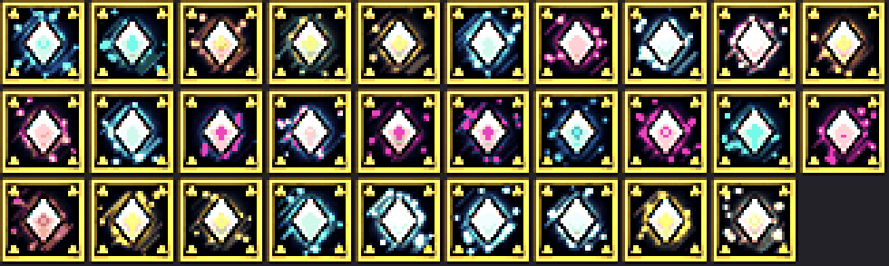
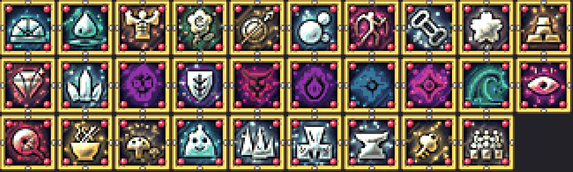
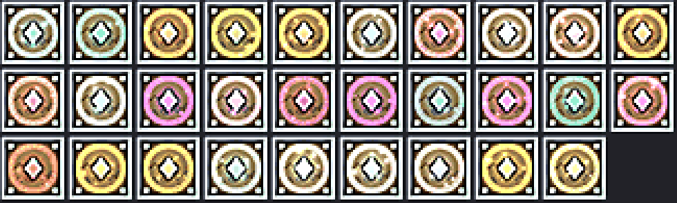
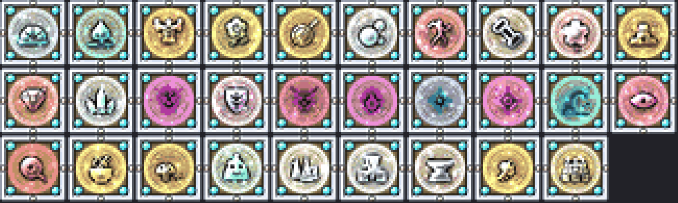
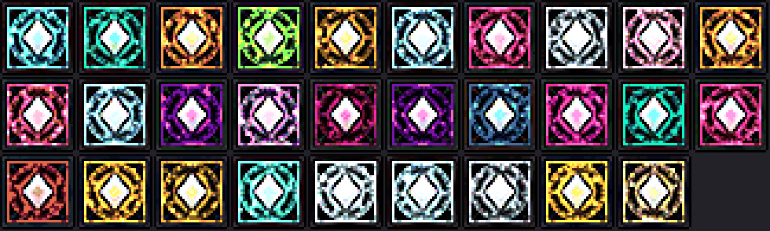
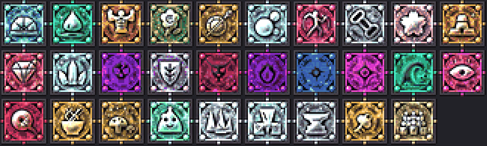
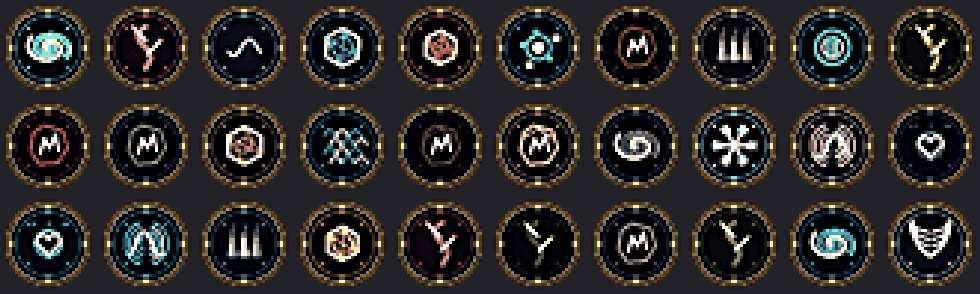
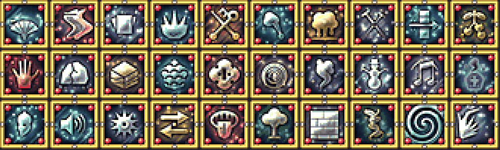

# Skill icons v2: redraw of the placeholder grimoire icons

Generator: `python tools/skills/gen_icons_v2.py` (deterministic: running it twice gives byte-identical PNGs).
Test: `SkillIconsV2Test` (reads `tools/skills/icons_v2.txt`, the list of every redrawn icon).
Old versions: `tools/skills/icons_classic/<same path under textures/skill>` (not in the jar).

## Audit (what was weak)

Contact sheets of `skill/grimoire` (107), `skill/icons` (76 magics x buff / ultimate, plus layers) and `skill/veldanava` were reviewed at 3x to 4x.

| Set | Finding | Verdict |
|---|---|---|
| 29 magics of the 0.53 expansion (barrier ... legion): `grimoire/`, `icons/<k>_buff`, `icons/<k>_ultimate`, `icons/sym_<k>` | `tools/icons/g_<key>.py` are marked `STUB`; all 29 draw the same small diamond, so 29 x 4 icons look alike and say nothing about the magic | **weak, redrawn (116 icons)** |
| 30 wiki magics (air ... wing): `grimoire/` only, round frame, from `tools/gen_grimoire_icons.mjs` | six motifs are shared: mud, rock, stone, shakudo, skin, red_ochre are the same letter M in a ring; hair, tongue, tree, vine, poison_plant the same Y; nail/spike the same three bars; soul/soul_corpse the same heart. Unreadable and near-duplicates at 32 px (centre diff of rock/stone 4.3 of 255) | **weak, redrawn (30 icons)** |
| 47 original magics (flame ... game), 3 variants each | relief emblem, aura / parchment / void background, gem frame: distinct and readable | kept (they are the style standard) |
| `grimoire/merged.png`, `mod_*`, `bg_*`, `sheet.png` | special layers / badges | kept |
| `skill/veldanava/*` (Hercules, Israfil, Jibril, Sandalphon, Solomon) | detailed, animated, pinned by `AnimatedIconsTest`; the `_classic` stills are fallbacks | kept, not touched |
| root icons, uniques, Beast Will, Dragon Ball | already reviewed fine | kept, not touched |

## What was built

The 59 magics each got a glyph of their own (themed to the magic, element or anime source) in `gen_icons_v2.py`, rendered through the same pipeline as `tools/icon_forge.py` (relief emblem lit from the top-left, aura / ancient-parchment / void background, gem frame in gold / silver / black iron), so the palette family is the existing one. Colours of Set A are exactly those of the old stubs; Set B keeps the colour of its old icon (a few dark browns were lifted to the same hue brighter so they read on the dark aura).

Set A (29): barrier = glass dome on a plate, black oil = oil drop over a slick, body = double-biceps pose, briar = rose on a thorned stem, bronze = hoplon shield and spear, bubble = three soap bubbles, butoh = dancer with shock rings, chain = three interlocked links, cherry blossom = five-petal sakura, copper = ingot stack, corundum = cut ruby, crystal = hexagonal prism cluster, curse = branded skull, curse warding = shield with ward rune, demon beast = horned hound head, demon fire = hollow black flame, demon ice = frost star of shards, demon light = black lens-flare star, demon water = hooked black wave, eye = almond tracking eye, eyeball = veined eyeball with nerve, food = steaming bowl, fungus = mushroom pair with spores, gel = grinning slime, glass = shard fan, ice wedge = wedge splitting the ground, iron = anvil, key = trefoil-bow key, legion = ranks of faceless constructs.

Set B (30): air = folding fan, hair = sweeping lock, memory = fanned photographs, mineral = geode, modification = spanner and screwdriver, mucus = goo lump with a sagging string, mud = dripping clump, nail = two crossed nails, permeation = arrow through a wall, poison plant = belladonna, red ochre = stencilled handprint, rock = cracked boulder, sandstone = strata block, scale = overlapping scales, shakudo = tsuba sword guard, skin = fingerprint ridges, smoke = curling column, snow = snowman, song = beamed notes, soul corpse = coffin with a wisp, soul = hitodama, sound = speaker and waves, spike = spiked ball, switching = swapping arrows, tongue = fanged mouth with tongue, tree = broadleaf tree, stone = masonry wall, vine = climbing vine, vortex = whirlpool, wing = feathered wing.

## NEW / REPLACED / KEPT

| | Count | What |
|---|---|---|
| **REPLACED** | 29 | `grimoire/<k>.png` of Set A |
| **REPLACED** | 29 | `icons/<k>_buff.png` of Set A |
| **REPLACED** | 29 | `icons/<k>_ultimate.png` of Set A |
| **REPLACED** | 29 | `icons/sym_<k>.png` (symbol layer) of Set A |
| **REPLACED** | 30 | `grimoire/<k>.png` of Set B (same path; round frame became the square gold frame of the other grimoire icons) |
| **NEW** | 0 resource files | no file name or id changed; new files are only tooling: `tools/skills/gen_icons_v2.py`, `tools/skills/icons_v2.txt`, `tools/skills/icons_classic/` (146 old PNGs), `SkillIconsV2Test`, this doc and its sheets |
| **KEPT** | everything else | the 47 original magics (incl. their 128 px `hd/` copies), `merged`, `mod_*`, `bg_*`, the Veldanava set, root / unique / Beast Will / Dragon Ball icons, `textures/skill/classic/` (3.86 originals) |

146 icons redrawn: Set A 116 (29 grimoire, 29 buff, 29 ultimate, 29 sym), Set B 30.

## Before / after

Order is the order of the generator tables (Set A: barrier ... legion; Set B: air ... wing). Each sheet is 10 icons per row at 3x, under 200 KB.

| Set | Before | After |
|---|---|---|
| A grimoire |  |  |
| A buff |  |  |
| A ultimate |  |  |
| B grimoire |  |  |

(Rebuild the sheets with `python tools/skills/gen_icons_v2.py --doc`.)

## Test

`SkillIconsV2Test` pins, for every redrawn icon of every set: it exists at its old path and is 32x32; no two icons of the same set are the same picture and none has a centre (the glyph, 18x18 px) that differs by less than 25 of 255 from another's; it fills its frame (more than 90 percent opaque; symbol layers more than 10 percent, so a stub speck fails); its old version exists under `tools/skills/icons_classic/` and differs from the new one; and nothing named `icons_classic` ships in the resources. Smallest centre difference now: 30.6 (buff set). With the old icons the same check fails in Set B (rock/stone 4.3) and in the symbol layers (bubble/crystal 1.5).

## Cost

Static 32 px textures at the same paths and size as before: no runtime, network or draw-cost change; no new entries in the jar (146 PNGs replaced, about the same size).

## Caveats (what could not be judged)

- Everything was judged on contact sheets (3x to 4x nearest-neighbour), not in a running game; no in-game slot, hover or colour-blind check was possible.
- Weakest of the new glyphs at 32 px, still readable but least convincing: black oil (the drop reads as generic), mucus, vine, ice wedge, barrier. Worth a second look by the owner.
- The `buff` variants draw the glyph at 64 percent scale (existing recipe), so fine details (e.g. the tsuba cut-outs) drop out there.
- Set B had only the active grimoire icon; no `_buff` / `_ultimate` were added for those 30 (none existed before and none was requested, so nothing changes for them).
- 128 px `hd/` copies were not made for the redrawn icons (the `hd/` folder holds only the 47 original magics and no Java code reads it).
- The wiki magics were themed from their names and the existing particle sprites (`gen_wiki_magic_textures.py`); the lore of the wiki magics (air, modification, memory ...) was not looked up, so a few symbols are the obvious reading of the name (rule 10 research was not done for this task).
